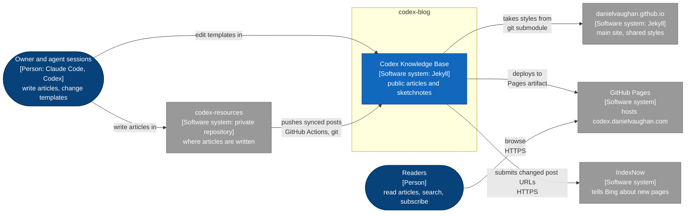
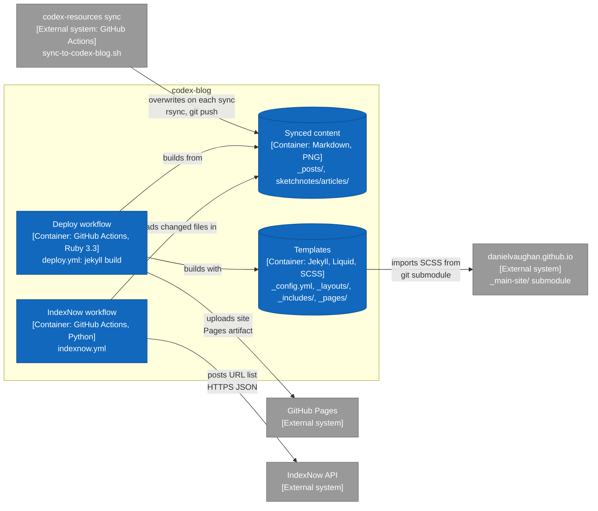

# Codex Knowledge Base

The public Jekyll site at <https://codex.danielvaughan.com>: practical articles and sketchnotes about agentic
software engineering with Codex, published from a private source repository.

[](https://github.com/danielvaughan/codex-blog/actions/workflows/deploy.yml)
[](https://github.com/danielvaughan/codex-blog/actions/workflows/indexnow.yml)

> **This README is the owner's guide to the repository**: what it can do, where everything is and its current
> state. Last reviewed in full on 21 November 2026; it is updated with every change.

- [At a glance](#at-a-glance)
- [Current state](#current-state)
- [Maps](#maps)
- [What is in this repository](#what-is-in-this-repository)
- [Landmarks](#landmarks)
- [How to run](#how-to-run)
- [Checks and tests](#checks-and-tests)
- [History and decisions](#history-and-decisions)
- [Working in this repository](#working-in-this-repository)
- [Glossary](#glossary)
- [Related repositories](#related-repositories)
- [Licence and credits](#licence-and-credits)

## At a glance

| | |
| --- | --- |
| **What it does** | Builds and serves the Codex Knowledge Base: dated articles, a sketchnote per article, 12 topic hubs, a tag index, search, an RSS feed, a sitemap and `llms.txt` |
| **Who uses it** | The public (readers and search engines); the sync workflow in `codex-resources`, which writes the articles; the owner and agent sessions, who change the templates |
| **Run it** | `bundle install && bundle exec jekyll serve`, then open <http://localhost:4000> |
| **State** | Live and publishing; every push to `main` deploys |
| **Work** | [Issues](https://github.com/danielvaughan/codex-blog/issues): 1 open on 21 November 2026 |
| **Decisions** | Design notes in [`docs/superpowers/specs/`](docs/superpowers/specs/); house rules in [AGENTS.md](AGENTS.md) |

## Current state

On 21 November 2026:

- The site is live at <https://codex.danielvaughan.com> on GitHub Pages, built by GitHub Actions (Pages source
  "GitHub Actions"), with HTTPS enforced and a certificate valid until 3 January 2027.
- `_posts/` holds 2,120 dated articles (26 March to 21 November 2026) plus a taxonomy page; `sketchnotes/articles/`
  holds 962 sketchnote PNGs. Articles published per month have fallen from 435 in April 2026 to 48 in October.
- The last sync arrived on 21 November 2026 (`chore: sync from codex-resources@f4f3c40`); its deploy and IndexNow
  runs passed. A deploy takes about 20 to 30 minutes.
- Open: [issue #1](https://github.com/danielvaughan/codex-blog/issues/1), a link update for the orchestrator
  landscape post. Article fixes belong upstream in `codex-resources`, not here.

## Maps

**Context:** the Codex Knowledge Base and who it serves.



Key: dark blue stadium = person; blue box = this repository's system; grey box = a system outside it; arrows read
in the direction of the label.

**Containers:** inside codex-blog.



Key: blue box = a part of this repository that runs; blue cylinder = files it keeps; grey box = outside it; arrows
read in the direction of the label.

## What is in this repository

| Path | What it holds |
| --- | --- |
| `_posts/` | 2,120 synced articles, `taxonomy.md` and the `SYNCED-DO-NOT-EDIT.md` marker. Written by the sync; never edit by hand |
| `sketchnotes/articles/` | 962 synced sketchnote PNGs, one per article, and the marker. Written by the sync; never edit by hand |
| `_config.yml` | Site settings: title, URL, permalinks, plugins, author, book promotion, IndexNow key, search verification codes |
| `_layouts/` | `default`, `home`, `post`, `page` and `topic` layouts |
| `_includes/` | Navbar, footer, book widget, related posts, in-body links, and head extras (Mermaid, Open Graph image, structured data) |
| `_pages/` | Search, tags and the topics index with 12 topic hubs |
| `_sass/`, `assets/` | Site styles (`codex-blog.scss`, `assets/css/main.scss`) and four images (avatar, Open Graph default, touch icon, framework figure) |
| `_main-site/` | Git submodule of `danielvaughan.github.io`, for its shared `_sass/` |
| `index.html` | Paginated home page (10 per page); must stay at the root |
| `llms.txt`, `search.json`, `robots.txt` | Generated machine-readable index, search index and crawler rules |
| `02bc222b25212df6c50e4a0673715a15.txt` | IndexNow ownership key file |
| `CNAME`, `favicon.ico` | Custom domain and icon |
| `docs/superpowers/` | Design specs and implementation plans from April 2026 (site design, reskin, shared code with the main site, book widget) |
| `.github/workflows/` | `deploy.yml` and `indexnow.yml` |
| `Gemfile` | `github-pages`, `jekyll-last-modified-at` and `webrick` |
| `.pre-commit-config.yaml`, `.gitleaks.toml` | Gitleaks secret scan, with the public verification codes allow-listed |
| `AGENTS.md` | Rules for agents: what may be edited here, naming, README and push rules |

## Landmarks

1. [`AGENTS.md`](AGENTS.md): what may be edited here and what must be fixed upstream.
2. [`_config.yml`](_config.yml): every site-wide setting in one place.
3. [`.github/workflows/deploy.yml`](.github/workflows/deploy.yml): how the site is built and deployed.
4. [`_layouts/post.html`](_layouts/post.html): what a reader sees on an article page.
5. [`_pages/topics/index.md`](_pages/topics/index.md): the topic hubs that organise the articles.
6. [`_posts/SYNCED-DO-NOT-EDIT.md`](_posts/SYNCED-DO-NOT-EDIT.md): the warning that these folders belong to the sync.
7. [`docs/superpowers/specs/2026-04-07-codex-blog-design.md`](docs/superpowers/specs/2026-04-07-codex-blog-design.md):
   why the site exists and how it was designed.

## How to run

Locally, with Ruby and Bundler:

```sh
git submodule update --init
bundle install
bundle exec jekyll serve
```

Then open <http://localhost:4000>. A full build of more than 2,000 posts is slow.

Publishing needs no command:

1. An article is written in `codex-resources/articles/` and pushed to its `main`.
2. Its `sync-to-codex-blog` workflow runs `scripts/sync-to-codex-blog.sh`, which mirrors articles into `_posts/` and
   sketchnotes into `sketchnotes/articles/` (deleting anything not in the source), rewrites image and cross-reference
   links, removes layout lines, normalises dates to UTC, adds `last_modified_at` from git history, escapes Liquid
   syntax in code fences, and commits here as `codex-blog-sync[bot]`.
3. That push runs `deploy.yml` (Jekyll build, upload, deploy to Pages) and, when `_posts/` changed, `indexnow.yml`.

`deploy.yml` can also be run by hand (`gh workflow run deploy.yml`) after a template change.

## Checks and tests

- CI: `deploy.yml` fails when the Jekyll build fails. Liquid runs in `warn` mode, so one bad article logs a warning
  rather than stopping the build.
- `indexnow.yml` fails when IndexNow rejects the ping.
- Pre-commit: Gitleaks (`pre-commit install`, then `pre-commit run --all-files`).
- No automated tests. Check a template change with a local `jekyll serve` and the live site after deploy.

## History and decisions

- 7 April 2026: created as the public face of the private `codex-resources` articles, first on the minimal-mistakes
  theme, then reskinned to match danielvaughan.com and sharing its styles through the `_main-site` submodule
  (submodule last moved 10 April 2026). Design notes are in `docs/superpowers/specs/`.
- 8 April 2026: book widget design; the site promotes the companion book from `_config.yml`.
- 24 May 2026: custom domain and Actions-based Pages build set from the GitHub web interface.
- The deploy uses `deploy.yml` rather than the native Pages build so non-whitelisted plugins such as
  `jekyll-last-modified-at` can run.
- Of 2,812 commits on 21 November 2026, 2,800 are syncs from `codex-resources`.

Traps:

- Editing `_posts/` or `sketchnotes/articles/` here is lost on the next sync. Fix articles upstream.
- A Liquid error in an article (`{{` or `{%` in a code fence) is fixed upstream, in the article or in
  `codex-resources/scripts/escape-liquid-in-fences.py`.
- The site is a knowledge base, never a "blog" in user-facing text, and it says "Codex", not "Codex CLI"
  ([AGENTS.md](AGENTS.md)).

## Working in this repository

- Branch `main`. Commit each finished change and push it to `origin main` in the same session; never force-push.
- The sync bot commits here several times a day, so always `git pull --rebase origin main` before pushing.
- Only templates and infrastructure are edited by hand; [AGENTS.md](AGENTS.md) lists them.
- This repository is public: nothing private goes in it.
- README: update it in the same commit as any change it describes (the `repo-readme` skill).

## Glossary

| Term | Meaning |
| --- | --- |
| Codex | OpenAI's coding agent, the site's subject |
| Sync | The `codex-resources` workflow that copies articles and sketchnotes here |
| Sketchnote | A summary image shown at the top of each article |
| Topic hub | A page in `_pages/topics/` grouping articles on one theme |
| IndexNow | An API that tells Bing and other engines about changed URLs |
| Liquid | Jekyll's template language; `{{` and `{%` in article code must be escaped |
| Pages artifact | The built site uploaded by `deploy.yml` for GitHub Pages to serve |

## Related repositories

| Repository | Visibility | What it is to this repository |
| --- | --- | --- |
| [codex-resources](https://github.com/danielvaughan/codex-resources) | Private | Private source of the articles and sketchnotes; its sync workflow writes `_posts/` and `sketchnotes/articles/` here |
| [danielvaughan.github.io](https://github.com/danielvaughan/danielvaughan.github.io) | Public | The main site, danielvaughan.com; a git submodule at `_main-site/` that shares its styles |

## Licence and credits

No licence file: all rights reserved by Daniel Vaughan. Articles and sketchnotes are written in `codex-resources`.
Built with Jekyll and the `github-pages` gem set.
