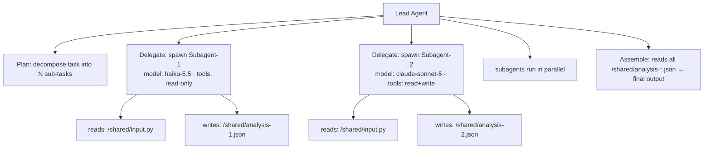

# Parallel Specialist Subagents: Anthropic's Multi-Agent Architecture in Practice


---

> *Anthropic's multi-agent orchestration ships a specific architecture: a lead agent that plans and delegates, and specialist subagents that execute in parallel on a shared filesystem. Understanding the architecture precisely matters because the performance improvements — 66 of 70 bugs found versus 27 for a single agent — come from the specialisation and the parallelism together, not from either alone.*

Anthropic announced multi-agent orchestration at Code with Claude SF 2026, alongside four other features: Dreaming, Outcomes, Claude Finance, and Add-ins.[^1] The announcement received the least technical coverage of the five, partly because "multi-agent" is an overloaded term. Every agent framework claims multi-agent support. What Anthropic shipped is a specific architecture with specific performance characteristics, and precision about what it is makes it practically useful.


## The Architecture

The Anthropic multi-agent model has three components:

**The lead agent** receives the original task. It is responsible for planning — breaking the task into sub-tasks that can be worked on independently, assigning each to a specialist, and assembling the final output from sub-task results. The lead agent does not execute the work itself; it coordinates.

**Specialist subagents** are provisioned per task. Each subagent has its own model selection, system prompt, and tool configuration, independent of the lead agent's configuration and of each other.[^1] A subagent handling static analysis might use a fast, cheap model (Claude Haiku 5.5, for example) with access only to read tools; a subagent handling architecture review might use a reasoning model with broader context. The specialisation is explicit and intentional, not an emergent property of a shared agent context.

**The shared filesystem** is the coordination mechanism. Subagents do not communicate through the lead agent's context window. They read inputs from and write outputs to shared file paths that the lead agent specifies in the task delegation. This prevents context explosion — the lead agent never has to hold the full working content of every subagent simultaneously — and makes the work auditable: every file written by every subagent is a persistent artifact.




## Why Specialisation Outperforms Single-Agent Generalisation

The benchmark result that most clearly demonstrates the value of this architecture is the bug-finding test: a single agent found at most 27 of 70 hidden bugs in a codebase; the multi-agent workflow consistently found 66.[^2] The gap is not primarily about parallelism — running the same generalised agent in parallel would not produce the same result. It is about specialisation.

A single agent working on a large codebase must context-switch between different classes of concern: security vulnerabilities, type errors, logic bugs, API misuse, performance regressions. Each context switch is a source of degraded attention. When the same problem space is partitioned across specialist agents — one for security, one for type correctness, one for logic — each agent can be prompted, tooled, and constrained for its specific domain. The security-focused agent's system prompt can include a detailed threat model; its tool access can be restricted to the inputs relevant to security analysis; its model can be selected for security reasoning specifically.

This is the same principle that makes human specialist teams outperform generalist individuals on complex problems. The orchestration layer coordinates; the specialists execute; neither tries to do both.


## Practical Patterns in Codex CLI

Codex CLI does not yet natively implement the Anthropic multi-agent orchestration API, but the architecture pattern is directly replicable using Codex CLI's existing primitives: worktrees for isolation, AGENTS.md for specialisation, and shell scripting for parallel execution.

### Pattern 1: Parallel code review with worktrees

```bash
#!/usr/bin/env bash
# multi-review.sh — parallel specialist code review
set -euo pipefail

TARGET_BRANCH="${1:-HEAD}"
SHARED=/tmp/review-$(date +%s)
mkdir -p "$SHARED"

# Security specialist
codex exec \
  --model o3-mini \
  --sandbox read-only \
  --codex-home .codex/profiles/security \
  "Review $TARGET_BRANCH for security issues. Write findings to $SHARED/security.md" &
PID_SEC=$!

# Type-correctness specialist
codex exec \
  --model o4-mini \
  --sandbox read-only \
  --codex-home .codex/profiles/types \
  "Review $TARGET_BRANCH for type errors and unsafe casts. Write findings to $SHARED/types.md" &
PID_TYPE=$!

# Logic specialist
codex exec \
  --model o3 \
  --sandbox read-only \
  --codex-home .codex/profiles/logic \
  "Review $TARGET_BRANCH for logic bugs, off-by-one errors, and incorrect assumptions. Write findings to $SHARED/logic.md" &
PID_LOGIC=$!

wait $PID_SEC $PID_TYPE $PID_LOGIC

# Lead agent assembles
codex exec \
  --model o3 \
  --sandbox read-only \
  "Read $SHARED/security.md, $SHARED/types.md, $SHARED/logic.md. \
   Synthesise a unified review report ranked by severity. Write to $SHARED/review.md"

cat "$SHARED/review.md"
```

Each specialist's `--codex-home` points to a profile directory with a domain-specific AGENTS.md:

```markdown
# .codex/profiles/security/AGENTS.md
## Security Review Specialist

You are performing a focused security review. Your only concern is:
- Injection vulnerabilities (SQL, command, prompt)
- Authentication and authorisation bypass
- Credential exposure (hardcoded secrets, logging PII)
- Dependency vulnerabilities (reference package-lock.json for known CVEs)

Do NOT comment on style, performance, or logic unrelated to security.
Write ALL findings to the path specified in your task — do not print to stdout.
One finding per section, severity: CRITICAL / HIGH / MEDIUM / LOW.
```

The domain-specific AGENTS.md is the mechanism that produces specialist behaviour. Without it, running the same generalised agent three times in parallel produces three nearly identical reviews.

### Pattern 2: Per-model cost routing

The Anthropic architecture allows each subagent to use a different model. This enables cost routing: fast and cheap models handle high-volume, lower-stakes tasks; expensive reasoning models handle the tasks that require deep inference.

For a codebase of 50,000 lines, a unified code review using `o3` across the entire codebase might consume \$12–18 in tokens. A routed architecture — `haiku-5.5` for style and minor issues, `o4-mini` for type correctness, `o3` only for security and logic — might achieve comparable or better coverage at \$3–5.

```toml
# .codex/profiles/style/config.toml
[model]
default = "claude-haiku-5.5"
sandbox = "read-only"
max_tokens = 4096

# .codex/profiles/logic/config.toml
[model]
default = "o3"
sandbox = "read-only"
max_tokens = 16384
```

The lead agent profile uses the highest-capability model only for synthesis — the narrowest part of the workflow.

### Pattern 3: Managed git worktrees for isolation

With v0.163.0-alpha.2's introduction of managed git worktree tools, subagents that need to make file changes can work in isolated branches without interfering with each other or the lead agent's view of the repository:

```markdown
# AGENTS.md — lead agent profile
## Worktree Coordination

When delegating write-access tasks to specialist subagents:
1. Create a managed worktree for each subagent: `create_worktree branch=agent/spec-{name}`
2. Pass the worktree path as the subagent's working directory
3. After all subagents complete, review each worktree's diff before merging
4. Merge only subagents whose changes pass the PostToolUse validation hooks
```

This pattern prevents the failure mode where parallel subagents with write access conflict on the same files.


## What the Performance Gap Tells Us

The 66-vs-27 bug finding result deserves closer examination. It is tempting to read it as an endorsement of "always use multi-agent." The more precise reading is: **multi-agent with specialised prompting and independent context outperforms single-agent generalisation on tasks that can be decomposed into independent sub-tasks with clear domain boundaries.**

Not all tasks meet that criterion. For tasks with strong sequential dependencies — where step N requires the full output of step N-1 before it can proceed — parallelism provides no advantage and the orchestration overhead (provisioning subagents, assembling results) adds latency. For tasks with highly interdependent concerns — where a security issue and a logic bug interact — breaking them into separate specialists risks missing the interaction.

The architect's decision is therefore: can this task be decomposed into sub-tasks with independent concerns and clear output contracts? If yes, the parallel specialist pattern is appropriate. If not, a single well-prompted agent with a broad context is simpler and likely faster.

The bug-finding case is well-suited to decomposition because the categories — security, types, logic — have largely independent concern spaces. A SQL injection vulnerability and a type error rarely interact; they can be reviewed by different specialists without loss of signal.


## Governance and Observability

The Anthropic architecture exposes subagent activity in Claude Console: "You can see what each sub-agent did, in what order, and inspect the reasoning behind task execution decisions."[^1] This observability property is architecturally significant. In a single-agent system, the reasoning trace is a single linear thread. In a multi-agent system, the trace is a tree: the lead agent's decisions, each subagent's execution, and the assembly step.

For enterprise governance — where organisations need to audit what an AI system did on their behalf — the tree structure is preferable to the linear trace. It maps naturally to the hierarchical review patterns that compliance teams understand.

For Codex CLI, the equivalent observability comes from the shared filesystem: every subagent's output file is a persistent, inspectable artifact. Coupling this with the opt-in output token replay feature in v0.163.0-alpha.2 (PR #52742) — which preserves encrypted content and tool outputs for audit — gives organisations a full post-hoc reconstruction of what each specialist agent did and why.


## Summary

Anthropic's parallel specialist subagent architecture delivers its performance gains through two mechanisms: specialised prompting that focuses each agent on a narrow domain, and parallel execution on a shared filesystem that avoids context explosion. The architecture is directly replicable in Codex CLI using per-profile AGENTS.md files, parallel `codex exec` invocations, and managed git worktrees for isolated write access. The 66-of-70 bug result is not universal — it applies to tasks that decompose cleanly into independent domains. The governance benefit — an auditable execution tree rather than a single linear trace — applies broadly, and is the stronger enterprise case for adopting the pattern.


## Citations

[^1]: [Code with Claude SF 2026: Anthropic Ships Outcomes and Multi-Agent Orchestration](https://www.claudeainews.com/news/code-with-claude-sf-2026-outcomes-multi-agent) — Claude AI News, 2026

[^2]: [Anthropic's Claude can now orchestrate up to 1,000 AI agents in parallel through dynamic workflows](https://the-decoder.com/anthropics-claude-can-now-orchestrate-up-to-1000-ai-agents-in-parallel-through-dynamic-workflows/) — The Decoder, 2026

[^3]: [Claude Subagents Explained: Multi-Agent Orchestration Guide 2026](https://getaitopia.io/blog/claude-subagents-explained-multi-agent-orchestration) — GetAITopia, 2026
