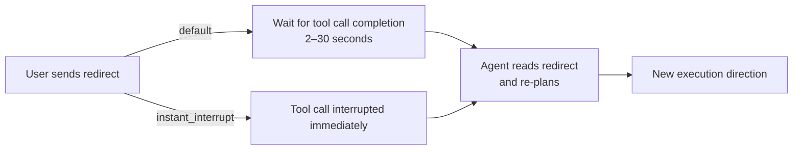

# instant_interrupt: How Codex's New Steering Mode Changes the Execution Model


---

> *`instant_interrupt` is a one-line config change with a fundamental architectural consequence: it turns Codex CLI from a request/response tool into a steerable process. The difference matters most during long agentic sessions, when an early wrong turn propagates for minutes before you can intervene.*

Codex CLI v0.159.0 shipped on 29 September 2026 with a flag that received minimal community attention compared to the same DevDay release cluster's `/agents` view (introduced in v0.156.0) and GPT-6.1 Sol (shipped as the default model in the same-day v0.159.1 patch).[^1] That flag — `instant_interrupt` — is, architecturally, more significant than either. It changes the fundamental interaction contract between a developer and a running Codex session.

This article explains what `instant_interrupt` does, why it matters, how to enable and configure it, and when you should deliberately leave it off.


## The Problem It Solves

In the default Codex CLI execution model, sending a new prompt while Codex is running has no immediate effect. Codex finishes its current tool call — which might be a multi-second shell command, a file write sequence, or a network request — before checking the input buffer. If you realise midway through a long agentic task that the agent has taken a wrong branch, you wait.

For short tasks, this delay is trivial. For long agentic sessions — a 20-minute refactor across 40 files, a test generation sweep, a documentation update that touches every chapter — the wait is expensive. The agent has already written 15 files by the time your Ctrl+C or redirect reaches it. Some of those writes may need to be reverted. Some may conflict with what you are about to redirect the agent to do.

The root cause is synchronous tool-call execution. Codex dispatches a tool call (a shell command, a file write, a web fetch) and blocks until the call completes before re-evaluating the interaction state. This is safe and predictable; it is also unresponsive.

`instant_interrupt` changes this. When enabled, new input from the user — a typed redirect, a keypress, a `^C` — interrupts the current tool call immediately and returns control to the user before the tool call completes. The model does not wait for the shell command to exit, the file write to flush, or the network request to return. It stops now.


## Enabling instant_interrupt

Add one line to `~/.codex/config.json`:

```json
{
  "instant_interrupt": true
}
```

Or in TOML format (`~/.codex/config.toml`):

```toml
instant_interrupt = true
```

The flag is opt-in and defaults to `false` in all releases through v0.162.1. There is no CLI flag equivalent — it must be set in the config file. The setting applies to all Codex sessions on the machine. There is no per-session or per-project override at the time of writing.


## What Changes in Practice

With `instant_interrupt` disabled (default), the interaction model looks like this:

```text
User: [sends redirect prompt]
Codex: [finishes current tool call — may take 2–30 seconds]
Codex: [reads redirect prompt]
Codex: [begins executing new direction]
```

With `instant_interrupt` enabled:

```text
User: [sends redirect prompt]
Codex: [stops current tool call immediately]
Codex: [reads redirect prompt]
Codex: [begins executing new direction]
```

The practical scenarios where this matters:

**Mid-refactor redirect.** You ask Codex to refactor the authentication module. Forty seconds in, you realise it is implementing the wrong pattern — it is building session-based auth but you need token-based. With `instant_interrupt`, typing "stop — use JWT token auth, not sessions" halts the refactor at the next natural break. Without it, you watch session-based auth spread through the codebase for another minute before the agent pauses.

**Wrong branch before it propagates.** Codex is generating tests. It has decided to use `unittest` style, but your project uses `pytest`. You notice after the first file. With `instant_interrupt`, a redirect to "use pytest style" takes effect before the pattern has been applied to twenty test files. Without it, you are reverting twenty files.

**Catastrophic tool call in progress.** Codex is executing a shell command that you realise is destructive — a broad `git clean`, a `DROP TABLE`, a recursive delete that you did not intend. `instant_interrupt` lets you stop it before completion. This is the most important use case, and also the one that illustrates why `instant_interrupt` is opt-in: it introduces a new class of partial-execution states where a tool call was stopped mid-way.




## The Partial-Execution Risk

Stopping a tool call mid-execution creates state that is neither complete nor cleanly absent. A file write interrupted halfway through leaves a partial file. A shell command interrupted during a multi-step pipeline leaves the system in an intermediate state. A network request interrupted after sending but before receiving leaves the remote system in an unknown state.

This is not a hypothetical risk. The v0.159.0 release notes include an explicit caveat.[^1] The safe use patterns are:

1. **Enable `instant_interrupt` for read-heavy sessions.** Analysis, code review, search, and planning tasks are safe to interrupt — reading a file or searching a codebase has no lasting side-effects. Write-heavy agentic sessions carry more risk.

2. **Use `instant_interrupt` with sandbox mode.** When Codex is running inside a sandbox (`sandboxPolicy: read-only` or `sandbox: true` in config), interrupted writes do not persist. Interrupting a sandboxed shell command is safe; the sandbox discards the partial state. This is the recommended combination for production agentic workflows.

3. **Review the interrupt point before issuing a redirect.** The TUI shows the current tool call in the status bar. If the tool call is a file write or a shell command with side-effects, consider whether interrupting it mid-call is safe. If not, wait for the call to complete before redirecting.

4. **Check `git status` after an interrupted session.** Partial file writes may appear as modified files in git. A quick `git diff` before committing verifies no corrupted files are in the staging area.


## instant_interrupt and fork: Steer vs. Branch

`instant_interrupt` is one of two mid-session interaction tools available in Codex CLI. The other is `fork`, triggered by pressing `f` in the TUI. They solve different problems.

| | `instant_interrupt` | `fork` |
|---|---|---|
| **What it does** | Stops the current execution and redirects | Creates a parallel branch from the current state |
| **Preserves original branch?** | No | Yes |
| **Use when** | The current direction is wrong | You want to explore an alternative without losing current progress |
| **Session cost** | Single session continues | Creates a new session (new context cost) |
| **TUI interaction** | Type new prompt or `^C` | Press `f` |

A practical distinction: if you are 80% through a task and want to try a different approach to the remaining 20%, use `fork` — you keep the work done so far and can compare the two branches. If the direction was wrong from the start and you want to discard the current path entirely, use `instant_interrupt` with a redirect prompt.

Both tools work together: interrupt the wrong branch, then fork from the corrected state to explore two implementation options in parallel.


## instant_interrupt in the /agents View

The `/agents` view, also introduced in v0.159.0, shows all running Codex agents in a single TUI panel.[^2] Each entry has a status indicator (running, waiting, complete, error), the current tool call, and controls including interrupt.

With `instant_interrupt` enabled, the interrupt control in the `/agents` panel becomes immediately effective. Without it, pressing interrupt sends a signal that takes effect only after the current tool call completes — which, for a slow shell command, may be 10–30 seconds after you pressed the button.

The combination of `/agents` + `instant_interrupt` is the intended multi-agent steering interface: monitor five parallel agents from a single pane, interrupt any of them immediately when their direction diverges, and resume with a redirect. This is the workflow described in the DevDay 2026 demo.[^3]

```text
/agents panel (v0.159.0+)
┌─────────────────────────────────────────────────────────┐
│ [running] agent-1  writing: src/auth/token.ts           │
│ [running] agent-2  running: npm test -- --watch         │
│ [waiting] agent-3  waiting for user approval            │
│ [running] agent-4  reading: docs/api-reference.md       │
│ [complete] agent-5 done: updated 12 test fixtures       │
└─────────────────────────────────────────────────────────┘
  Press [i] to interrupt selected agent immediately (instant_interrupt: true)
  Press [f] to fork selected agent into a new branch
```


## When NOT to Enable instant_interrupt

There are contexts where `instant_interrupt` should be left at its default of `false`:

**CI pipelines and automation.** Any context where there is no human at the keyboard to issue intentional interrupts. An accidental keypress in a CI log viewer or a runaway tool should not halt a release pipeline mid-execution. `instant_interrupt` is a human-in-the-loop feature; in fully automated contexts, it creates risk without value.

**Write-intensive tasks without sandbox.** Generating large volumes of files — a full test suite, a documentation site, a migration script — where partial execution leaves files in an inconsistent state. If you cannot run in sandbox mode, and the task is write-intensive, the default synchronous model is safer.

**Non-interactive terminal contexts.** Sessions running inside `screen`, `tmux` panes shared between users, or terminal multiplexers where keypress interception is unreliable. Stray keystrokes from pane-switching can trigger unintended interrupts.

**Tasks with external side-effects.** Anything that calls external APIs, sends emails, writes to a database, or modifies shared infrastructure. A partial call to an external system can leave the remote end in an inconsistent state that is harder to recover than a partial local file write.

The general rule: enable `instant_interrupt` when you are working interactively and the task is primarily local, and disable it (or leave it at default) when the task is automated or touches systems that are hard to recover from partial writes.


## The UX Signal: Removing Follow-Up Prompt Suggestions

v0.159.0 also removed the "follow-up prompt suggestions" feature — the TUI hints that appeared after each response, suggesting what to ask next. The removal happened in the same release as `instant_interrupt`.

This pairing is a deliberate signal. Follow-up suggestions are a hand-holding affordance: they anticipate what a less-experienced user might want to do next. `instant_interrupt` is an expert control: it assumes the user knows what they want and can issue precise mid-session redirects. Shipping both changes in the same release, in opposite directions, communicates a product direction: Codex CLI is optimising for experienced practitioners who steer precisely, not for users who need guidance on what to do next.

This is consistent with the broader DevDay 2026 release cluster theme. The `/agents` view is a power-user monitoring interface. GPT-6.1 Sol as default (v0.159.1) shifts cost assumptions for teams running many parallel agents. `instant_interrupt` gives those agents a steering control they did not have. Taken together, the v0.159.x release cluster is aimed at teams running Codex at scale, not individuals running it occasionally.


## Architecture Implications

`instant_interrupt` is not just a UX affordance — it changes the execution model in a way that affects how you architect long agentic sessions.

In the synchronous model, each step of an agentic task is an atomic unit: the tool call completes, the result is appended to context, the model generates the next step. State is always consistent at the boundaries between steps.

With `instant_interrupt`, tool calls are no longer atomic from the user's perspective. The user can observe and interact with Codex at a finer granularity than the step boundary. This means:

- **Context window state at interrupt time may not represent a clean step boundary.** The model was mid-execution. The redirect prompt is injected into a context that contains a partial tool result or a truncated tool call. Codex handles this gracefully in most cases, but complex tool call sequences (multi-step shell pipelines, nested file operations) may produce unexpected behaviour if interrupted at specific points.

- **Long agentic sessions benefit from checkpoint discipline.** If you are running a session where you plan to use `instant_interrupt` actively, structuring the session into explicit checkpoint phases — "complete the analysis, then I will review before writing" — reduces the risk of interrupting at a problematic point. The `/ask` approval policy is complementary: it pauses before writes, giving a natural decision point that does not require `instant_interrupt`.

- **Testing `instant_interrupt` behaviour.** If you are building tooling on top of Codex CLI (wrapper scripts, orchestration layers), `instant_interrupt` changes the assumptions your tooling can make about completion signals. A tool call that was reliable and atomic is now interruptible. Any code that polls for Codex task completion should handle interrupted states explicitly.


## Summary

`instant_interrupt` is a single-line opt-in config change that converts Codex CLI from a synchronous request/response model to a steerable interactive process. The practical benefit is immediate: you can redirect a running agent without waiting for it to finish its current tool call. The risk requires care: interrupted tool calls leave partial state that you must be aware of.

Enable it when you are working interactively, especially in sandbox mode or on read-heavy sessions. Disable it in CI, automation, and write-intensive sessions without sandbox protection. Use it together with `fork` to distinguish between "this direction is wrong" (interrupt + redirect) and "I want to explore both options" (fork).

The combination of `instant_interrupt`, `/agents`, and `fork` is the first complete set of mid-session steering controls in Codex CLI. Understanding how they interact — and when to use which — is the practical skill that separates a practitioner who runs one careful agent at a time from one who runs five parallel agents with confidence.

---

[^1]: Codex CLI v0.159.0 release notes — `instant_interrupt` flag for immediate agent interrupt. 29 September 2026.
[^2]: Codex CLI v0.159.0 release notes — `/agents` view for multi-agent monitoring. 29 September 2026.
[^3]: OpenAI DevDay 2026 keynote demonstration — `/agents` view and `instant_interrupt` in a five-agent parallel workflow. 29 September 2026.
