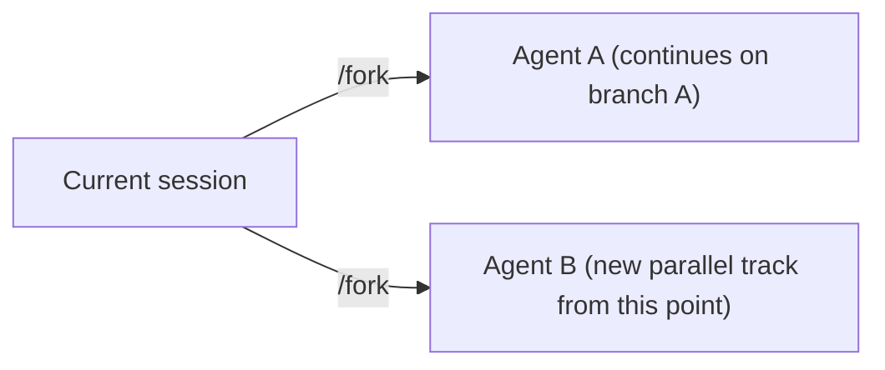

# The /agents View: Managing Parallel Codex Tasks from One CLI Session


---

> *Before /agents, running five parallel Codex tasks meant five terminal tabs with no shared overview. The /agents view is the missing coordination layer: a single pane that shows all running tasks, their status, and the controls to steer or interrupt them.*

OpenAI's DevDay 2026 keynote included a feature that received less community coverage than GPT-6.1 Sol or the Codex Cloud demo, but which changes the practical experience of multi-agent development more directly than either: the `/agents` view.[^1]

The `/agents` view is a new TUI command available from any Codex CLI session. It replaces the five-terminal-tab model for parallel task management with a single consolidated pane: all running agents, their status, progress indicators, and the controls to steer them — including the `instant_interrupt` capability introduced in v0.159.0.

This article explains the `/agents` interface, how it connects to `/fork` and `instant_interrupt`, and how to set up and monitor a multi-agent session from one terminal.


## The Problem Before /agents

Multi-agent Codex workflows using `--worktree` require a separate terminal session per agent. If you are running five parallel tasks — a frontend refactor in one worktree, a backend service rewrite in another, test generation in a third, documentation updates in a fourth, and a database migration in a fifth — you have five terminals open, each needing individual attention.

The practical problems:

- **No shared status overview.** You cannot see at a glance which tasks are running, blocked, waiting for approval, or complete. You check each terminal in turn.
- **Context switching overhead.** Switching to an agent to steer it requires switching terminal tabs, reorienting, and re-engaging with that session's current state.
- **No coordinated interrupt.** If a shared dependency changes and you need to redirect multiple agents, you visit each terminal individually.

The `/agents` view solves all three. It is not a new execution model — the underlying worktrees and session architecture are unchanged. It is a coordination layer over the existing multi-agent substrate.


## The /agents Interface

Open the `/agents` view from any active Codex session:

```text
/agents
```

The view opens as a fullscreen TUI panel with a list of all currently active agents (agents started from the same CLI session or from the same named environment). Each agent entry shows:

- **Agent name / session identifier** — the label assigned at fork or session creation
- **Status indicator** — running / waiting for approval / complete / blocked / interrupted
- **Task summary** — a rolling one-line summary of what the agent is currently doing
- **Token usage** — tokens consumed against the session budget for this agent
- **Time elapsed** — wall-clock time since the agent started

Navigation is keyboard-driven: arrow keys to move between agents, `Enter` to expand an agent's full session transcript, `i` to send a steering message, `x` to interrupt.


## How /agents Connects to /fork

The `/fork` shortcut (introduced in v0.157) is the mechanism for spinning up a new parallel agent. In any session, pressing `f` (or typing `/fork`) creates a new worktree-backed session that inherits the current session's context and continues from the same point.



Both agents appear in the `/agents` view immediately after the fork. If you fork from within the `/agents` view, the new agent appears in the list without requiring any additional navigation.

The typical multi-agent setup:

```bash
# Start the primary session
codex

# Fork into parallel agents for each major task area
/fork --name frontend-refactor
/fork --name backend-service
/fork --name test-generation
/fork --name docs-update

# Open the agents view to monitor all four
/agents
```

From `/agents`, all four parallel tracks are visible and steerable from one pane.


## instant_interrupt in the /agents View

The `instant_interrupt` feature — introduced in v0.159.0 and covered in detail in its [own article](2026-10-12-instant-interrupt-codex-steering-execution-model-change.md) — changes what "steering" means in the `/agents` view.

Without `instant_interrupt`, sending a message to a running agent queues it: the message is held until the agent finishes its current tool call. With `instant_interrupt` enabled, the message redirects the agent immediately — it stops what it is doing and processes the new input.

In the `/agents` view, `instant_interrupt` changes the `i` (send steering message) action from "queue for next turn" to "interrupt now." The status indicator updates to show the agent has been interrupted and is processing the new direction.

This matters most when you notice a running agent has taken a wrong branch. Without `instant_interrupt`, you watch it continue in the wrong direction until its current tool call completes. With `instant_interrupt`, you redirect it the moment you see the problem.

Enable `instant_interrupt` in `config.toml`:

```toml
[session]
instant_interrupt = true
```

Or via `--instant-interrupt` at session start. The setting applies to all agents started in or forked from the session.

**Caution**: `instant_interrupt` is not appropriate for agents running write-intensive tasks without sandbox containment. An interrupt mid-write can leave files in a partially-written state. Use it with `sandboxPolicy` enabled, and be aware that operations already dispatched (shell commands in flight, network requests initiated) are not always cancellable even when the agent receives the interrupt signal. The `/agents` view will show which pending tool calls have not yet returned.


## Practical Walkthrough: Five-Agent Frontend/Backend Split

The standard use case for `/agents` is a parallel architecture task: splitting work across specialised agents with clear boundaries and monitoring them from one pane.

**Setup**

```toml
# AGENTS.md additions for the session
## Multi-Agent Coordination

### Agent Roles
- **frontend-refactor**: Owns `src/components/` and `src/pages/`. Do not modify backend API files.
- **backend-service**: Owns `src/api/` and `src/services/`. Do not modify frontend components.
- **test-generation**: Reads the full `src/` tree, writes to `tests/` only.
- **docs-update**: Reads source files, writes to `docs/` only.
- **migration**: Owns `db/migrations/`. Do not run migrations, only create migration files.
```

**Session start**

```bash
codex --instant-interrupt
```

**Fork into parallel agents**

```text
> /fork --name frontend-refactor --prompt "Refactor all React components in src/components/ to use the new design system tokens"
> /fork --name backend-service --prompt "Update all service handlers in src/api/ to return the new response schema"
> /fork --name test-generation --prompt "Generate unit tests for all functions in src/services/ that do not yet have coverage"
> /fork --name docs-update --prompt "Update the API reference in docs/ to match the new response schema"
> /agents
```

The `/agents` view now shows all four parallel tasks. You can:

- Monitor progress without switching terminals
- Steer any agent by selecting it and pressing `i`
- Interrupt an agent that has gone off-track with `x`
- Expand an agent's transcript with `Enter` to understand its current decisions
- See approval queue status — agents waiting for Guardian or user approval appear with a distinct status indicator


## Approval Events in the /agents View

When an agent triggers an approval event, the status indicator in `/agents` changes to "awaiting approval." If you are using `approvals_reviewer = "guardian_subagent"`, Guardian handles the review automatically and the indicator transitions back to "running" without user action.

If Guardian escalates or if you are using a policy that requires human approval, the `/agents` view highlights the waiting agent. Pressing `Enter` on a waiting agent shows the approval request inline — you can approve or deny without leaving the `/agents` view and without switching to that agent's terminal session.

This is the most direct practical improvement over the multi-terminal model: approvals surface to the coordination view rather than requiring you to monitor each agent's terminal for approval prompts.


## The /agents View and the instant_interrupt Article

The `instant_interrupt` article published on 12 October 2026 explicitly references the `/agents` view as the intended pairing: enabling `instant_interrupt` is most useful when you can monitor running agents from a single pane and redirect them the moment you see an issue.[^2]

The two features form a complete real-time coordination layer for multi-agent Codex sessions:

- `/agents` provides visibility across all running tasks
- `instant_interrupt` provides the ability to act immediately when something needs redirecting

Without `/agents`, `instant_interrupt` requires you to be in each agent's session to use it. Without `instant_interrupt`, `/agents` provides visibility but delayed steering. Together, they are the practical multi-agent monitoring toolkit that makes parallel Codex development workable at five or more agents.


## When Not to Use the /agents View

The `/agents` view adds value when you have multiple concurrent agents and need coordinated oversight. For single-agent sessions or sequential tasks, it adds no value — it is a list of one agent, which is just the main session.

For teams running Cloud Environment tasks (where the execution happens remotely), the `/agents` view works the same way but shows cloud-backed sessions rather than local worktrees. The interface is identical; the difference is that cloud sessions persist if you disconnect.

---

[^1]: OpenAI — "Live from OpenAI DevDay 2026: Keynote (FULL)" (29 September 2026). The /agents view was announced alongside Codex Cloud, GPT-6.1 Sol, Code Review, and Codex Security Cloud. Available at: https://youtube.com/watch?v=Fls_onRviPM

[^2]: "instant_interrupt: How Codex's New Steering Mode Changes the Execution Model" (12 October 2026) — covers `instant_interrupt` in depth and references `/agents` view as the intended pairing. Available at: https://danielvaughan.github.io/codex-resources/2026-10-12-instant-interrupt-codex-steering-execution-model-change

[^3]: Codex CLI v0.157.0 release notes — `/fork` shortcut and `f` keybinding introduced. Available at: https://github.com/openai/codex/releases/tag/v0.157.0

[^4]: Codex CLI v0.159.0 release notes — `instant_interrupt` flag and removal of follow-up prompt suggestions. Available at: https://github.com/openai/codex/releases/tag/v0.159.0

[^5]: OpenAI DevDay 2026 — /agents view demo. Context: five parallel worktrees consolidated into one pane with status indicators, progress display, interrupt controls, and session creation. Available at: https://youtube.com/watch?v=Fls_onRviPM
