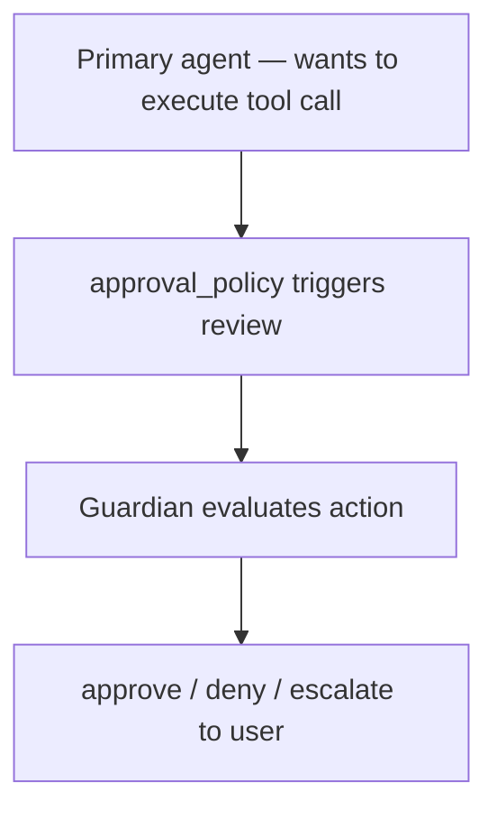

# The Guardian Subagent: How Codex v0.160.0's Risk-Based Approval Framework Works


---

> *Guardian has been part of Codex CLI's safety stack since v0.119. With v0.160.0, it gained the ability to apply opt-in context from earlier sessions and agent handoffs. This article explains what the Guardian subagent actually does, how to configure it, and when automated approval makes sense.*

When Codex CLI asks for permission before executing a shell command or writing a sensitive file, something has to decide: approve, deny, or ask the human. Before Guardian, the answer was always the latter — every approval prompt surfaced to the terminal and waited for a keystroke. That is acceptable for short sessions. For long agentic tasks with dozens of approval events, it is a constant interruption that defeats the purpose of running an autonomous agent.

The Guardian subagent changes this. When configured, Guardian intercepts approval requests and applies a risk-based evaluation — returning an approve or deny decision without surfacing the prompt to the user. v0.160.0 extended Guardian further: it can now retrieve context from earlier user instructions and agent handoffs, enabling policy continuity across sessions and multi-agent chains.

This article covers what Guardian evaluates, how to enable and configure it, and the practical boundaries of automated approval.


## What the Guardian Subagent Is

Guardian is a reviewer subagent built into Codex CLI's safety stack. It runs as a lightweight model call, separate from the primary agent, and its job is to evaluate a proposed action against a risk framework before approving it.

The relationship is:



Guardian has been available since v0.119 (April 2026), when Smart Approvals routing was introduced.[^1] What v0.160.0 adds is **context persistence**: Guardian can now access earlier user instructions from the session and, in multi-agent setups, root-context from parent agents — preventing context collapse when reviewing actions deep in an agent chain.


## What Guardian Evaluates

When an approval event reaches Guardian, it evaluates the action across four dimensions:

**1. Operation type**
Shell commands, file writes, network requests, and MCP tool invocations are weighted differently. A `cat` of a text file in the repo root carries near-zero risk. A `curl` to an external host, or an `rm` outside the working directory, triggers higher scrutiny.

**2. File path scope**
Writes inside `writable_roots` and reads inside `readable_roots` are lower-risk. Operations that extend beyond declared scopes — or that touch paths associated with credentials, shell configs, or system directories — escalate.

**3. Network destination**
Guardian checks outbound hostnames against declared MCP server origins and known-safe patterns. Calls to novel external hosts flag as elevated risk.

**4. MCP server provenance**
Tool invocations from marketplace-sourced or externally-hosted MCP servers are reviewed more conservatively than invocations from servers explicitly configured in `config.toml`.

Guardian does not use static rules. It evaluates in context — which means similar operations may receive different decisions depending on what the session has declared, what the primary agent was asked to do, and whether the action is consistent with prior user instructions.


## Enabling Guardian Review

Guardian review is opt-in. The key config value is `approvals_reviewer`:

```toml
# ~/.codex/config.toml

[approval]
approvals_reviewer = "guardian_subagent"
```

With this set, all approval requests that would previously have paused the agent and waited for a keypress are instead routed to Guardian. The agent continues without surfacing the prompt unless Guardian escalates.

You can still use `approval_policy` alongside this setting to control which actions trigger review in the first place:

```toml
[approval]
approvals_reviewer = "guardian_subagent"
approval_policy = "auto-edit"      # only shell commands require review
```

With `approval_policy = "auto-edit"`, file edits proceed without review; shell commands go through Guardian. With `full-auto`, all actions proceed through Guardian's automated gate rather than the user.


## v0.160.0: Context Persistence and Handoff Context

The Guardian upgrade in v0.160.0 adds two optional context sources.[^2]

**Session instruction context**

Guardian can now retrieve earlier user instructions from the session thread. If you told Codex at the start of a session "Only write to the `src/` directory and never touch migration files," Guardian factors that instruction into later approval decisions — even if the primary agent has long since moved on to other tasks and the instruction is no longer in the active context window.

Enable this with:

```toml
[guardian]
use_session_instruction_context = true
```

**Handoff context (multi-agent sessions)**

In sessions that use `multi_agent_v2` with spawned subagents, Guardian can now select root-level evidence from the originating agent when reviewing actions taken by a worker. Previously, if a worker agent triggered an approval event, Guardian only saw the worker's local context — which might be a narrow slice of the full task. With `guardian_root_handoff_context` enabled, Guardian sees what the orchestrator told the worker, giving it the full policy picture.

```toml
[guardian]
guardian_root_handoff_context = true   # off by default
```

Both options are disabled by default. Enabling them increases Guardian's decision quality at the cost of marginally higher latency per approval event.


## Combining Guardian with Sandbox Policy

Guardian and `sandboxPolicy` address different layers of the safety stack and work better together than as alternatives.

`sandboxPolicy` is a hard boundary: operations outside declared roots fail at the OS level, regardless of what the agent or Guardian decides. Guardian is a soft gate: it evaluates intent and context and can approve or deny based on risk reasoning, but it cannot enforce what `sandboxPolicy` prevents.

The recommended pattern for sensitive workflows:

```toml
[approval]
approvals_reviewer = "guardian_subagent"
approval_policy = "suggest"

[sandbox]
enabled = true
writable_roots = ["./src", "./tests"]
network_mode = "restricted"
allowed_hosts = ["api.internal.example.com"]
```

Here, `sandboxPolicy` ensures the agent cannot write outside `src/` or `tests/` regardless of Guardian's decisions. Guardian handles the finer-grained questions within those boundaries: which shell commands are consistent with the declared task, which MCP tool invocations look anomalous, which network calls match declared patterns.


## When Automated Approval Makes Sense

Guardian is not a substitute for human oversight in all contexts. Three conditions support its use:

**Well-scoped sessions with declared `writable_roots`**
If the session has explicit scope declared in `sandboxPolicy`, Guardian's decisions are bounded. The worst case is an approved action within the declared boundary — not an action that escapes it.

**Long-running tasks with repetitive approval patterns**
A test generation sweep that writes 80 test files will trigger dozens of approval events for structurally identical operations. Guardian handles these correctly and faster than a human stopping at each one.

**Multi-agent sessions with orchestrator/worker topology**
With `guardian_root_handoff_context` enabled, Guardian maintains policy coherence across agent boundaries — which is difficult to achieve with manual approval in sessions where workers are spawned dynamically.

Three conditions argue against automated approval:

**External side effects that are difficult to reverse**
Payments, email sends, webhook calls to production systems — operations where a false approve has real-world consequences. Route these to manual approval even with Guardian enabled, using a targeted `[tools.X]` approval override.

**CI/CD pipelines and non-interactive contexts**
Guardian is designed for interactive sessions. In headless CI runs, the risk model and session-instruction context are less reliable. Use `approval_policy = "full-auto"` with `sandboxPolicy` enforcement for CI rather than relying on Guardian.

**Codebases with sensitive credential paths in `writable_roots`**
If the declared writable scope includes directories that also contain credentials or secrets, `sandboxPolicy` enforcement is more reliable than Guardian's path-risk heuristics.


## Audit Logging

All Guardian decisions are recorded in the session rollout log with a structured entry:

```json
{
  "type": "guardian_decision",
  "action": "approve",
  "operation": "shell_exec",
  "command": "npm run test -- --coverage",
  "risk_score": 0.12,
  "context_sources": ["session_instructions"],
  "timestamp": "2026-10-17T09:34:21Z"
}
```

The `risk_score` (0–1) and `context_sources` fields let you audit why Guardian decided what it did. High `risk_score` values with `approve` decisions are worth reviewing — they indicate borderline cases where Guardian's evaluation diverged from what a conservative human reviewer might decide.


## Practical Configuration Starting Point

For a team running Codex CLI on a codebase with an established `sandboxPolicy`, this is a solid baseline:

```toml
# ~/.codex/config.toml

[approval]
approvals_reviewer = "guardian_subagent"
approval_policy = "auto-edit"

[guardian]
use_session_instruction_context = true
guardian_root_handoff_context = false   # enable when using multi_agent_v2

[sandbox]
enabled = true
writable_roots = ["./src", "./tests", "./docs"]
network_mode = "restricted"
```

This setup routes shell command approval to Guardian (file edits proceed automatically), gives Guardian access to session-level instructions, and keeps the sandbox boundary as the hard outer constraint.

Guardian will not replace human review for every session. But for teams running long agentic tasks with repetitive approval patterns, it eliminates the bottleneck that makes "full-auto with sandbox" impractical — the constant interruptions that arrive precisely when you have stepped away.

---

[^1]: Codex CLI v0.119.0 release notes (April 2026) — Smart Approvals routing to guardian subagent introduced. Available at: https://github.com/openai/codex/releases/tag/v0.119.0

[^2]: Codex CLI v0.160.0 release notes (1 October 2026) — Guardian session instruction context and `guardian_root_handoff_context` opt-in. Available at: https://github.com/openai/codex/releases/tag/v0.160.0

[^3]: Codex CLI AGENTS.md specification and config reference — approval policy, sandbox policy, and Guardian configuration. Available at: https://github.com/openai/codex/blob/main/AGENTS.md

[^4]: skills-hub.ai — "OpenAI Codex CLI Recent Releases 2026" (October 2026). Available at: https://skills-hub.ai/blog/openai-codex-cli-recent-releases-2026

[^5]: Codex CLI v0.153.0 release notes (3 September 2026) — Guardian Full Access Mode bypass and Guardian history fencing. Available at: https://github.com/openai/codex/releases/tag/v0.153.0
