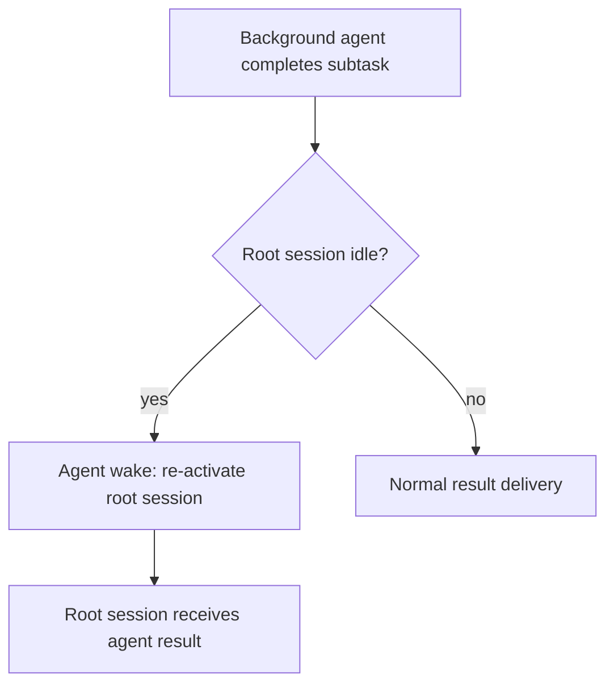

# Codex CLI v0.164.0 Alpha Preview: Agent Wake, Multi-Environment File Copy, and Observation Hooks


---

> *Eight alphas shipped in five days (as of 20 Oct). v0.164.0 is shaping into a multi-environment orchestration release, adding agent-initiated session wake, cross-environment file transfer, live MCP tool discovery, and passive observation hooks for telemetry — all before a stable tag.*

v0.163.0 stable tagged on 15 October. Within 24 hours, the v0.164.0 alpha sprint had opened. By the end of 19 October, six alphas had shipped — three in the first 36 hours, two more during the day, and a sixth at 22:48 UTC — with the weekend commits between alpha.3 and alpha.4 containing some of the most architecturally significant changes in the sprint. Two further alphas (alpha.7 and alpha.8) shipped on 20 October after this article's original publication.

This article covers the alpha.1–alpha.6 run: what shipped, why the agent wake and observation hooks commits matter beyond their immediate feature scope, and what configuration changes to track before stable lands.


## Sprint Timeline

| Release | Date | Key changes |
|---------|------|-------------|
| v0.164.0-alpha.1 | Oct 16, 14:49 UTC | Multi-env file copy opt-in; live MCP tool-list updates; memory efficiency |
| v0.164.0-alpha.2 | Oct 16, 17:37 UTC | Slash command prefix markers; typed prompt fragments; MCP approval reason tracking |
| v0.164.0-alpha.3 | Oct 17, 04:03 UTC | macOS daemon priority fix; strict TUI config policy; zip 9.0.0 |
| v0.164.0-alpha.4 | Oct 19, 10:42 UTC | Agent wake (feature flag); zstd WebSocket compression; catalogue cache across credential rotation; observation hooks |
| v0.164.0-alpha.5 | Oct 19, 14:23 UTC | Release pruning; additional stability fixes |
| v0.164.0-alpha.6 | Oct 19, 22:48 UTC | Stabilisation fixes; shipped after this article's original publication[^9] |
| v0.164.0-alpha.7 | Oct 20, 13:47 UTC | Stabilisation fixes; post-publication[^10] |
| v0.164.0-alpha.8 | Oct 20, 22:15 UTC | Stabilisation fixes; post-publication[^10] |

The gap between alpha.3 (Oct 17) and alpha.4 (Oct 19) reflects weekend development — five commits landed Saturday and Sunday that did not immediately produce an alpha tag but form the core of alpha.4's substance.[^1]


## Multi-Environment File Copy

The headline feature of alpha.1 is `multi_env_copy_file`: a new opt-in tool that allows agents to copy files between Codex Cloud environments.[^2]

Previously, moving data between environments required manual exfiltration — downloading a file from one environment and re-uploading it to another, or using a shared MCP server as a relay. With `multi_env_copy_file`, the agent can invoke the copy operation directly within a task.

The capability is gated behind a feature flag, enabled in `config.toml`:

```toml
[features]
multi_env_copy_file = true
```

The operational implication is significant: agents running in parallel across Cloud environments can now share artefacts without user-mediated handoffs. Combined with the agent wake capability (see below), v0.164.0 is building toward long-running multi-environment pipelines where agents coordinate directly rather than waiting for a human to act as courier.

**Practical note:** The feature is opt-in with good reason. Cross-environment file copy creates new paths for unintentional data movement — particularly in workflows where environments map to different security contexts (production vs staging, personal vs enterprise). Evaluate your `writable_roots` configuration for each environment before enabling.


## Live MCP Tool-List Updates

The second alpha.1 change resolves a longstanding friction point in dynamic MCP configurations: tool-list changes made during a conversation turn are now honoured immediately.[^3]

Previously, if an MCP server updated its capabilities — adding or removing tools — the change was invisible until the user restarted the session. This made it impractical to use Codex with MCP servers that modify their tool surface at runtime (authentication state changes, capability-gated tools, admin versus user role switching).

With the alpha.1 change, Codex checks for tool-list deltas within a turn. A server that exposes additional tools after an OAuth flow completes will have those tools available to the agent immediately, without a session restart.

No configuration is required. MCP server metadata preservation (a companion commit in alpha.1) ensures the tool-list state is correctly tracked across turns even for servers with multiple tools in partial approval states.


## Typed Prompt Fragments

Alpha.2 and alpha.3 introduce typed content in contextual prompt fragments.[^4] This is an internal plumbing change with downstream effects for multi-modal and mixed-content workflows.

The previous prompt fragment pipeline treated all contextual content as undifferentiated strings. Typed fragments add explicit discrimination — the fragment carries a type annotation alongside its content. This enables the pipeline to handle images, structured data, and rich text as first-class contextual inputs, not strings that happen to contain markup.

Combined with the streaming file replacement work that landed in the post-v0.163.0 day-after commits (12 October), typed fragments suggest v0.164.0 will meaningfully extend what agents can include in context without manual formatting on the user's side.

The practical effect for most users is that context injection via MCP tools and `contextual_prompt` will become more reliable when the payload contains non-text content.


## Agent Wake

The most architecturally significant change in the sprint is in a weekend commit, not a formal alpha release note: agent wake.[^5]

The commit description is spare — "Allow agent messages to wake idle root sessions (behind feature flag)" — but the implication is a structural shift in how Codex CLI workflows can be initiated.

Previously, Codex sessions were user-initiated. A human opened a terminal, typed a prompt, and the session started. Background agents (running via `codex agents` or `codex queue`) could execute tasks, but they could not re-engage an idle root session autonomously. The human was always the trigger.

Agent wake removes that constraint. With the feature flag enabled, a background agent can send a message that re-activates an idle root session — effectively making the agent a session initiator, not just a session participant.



This is the architectural primitive that long-running multi-agent workflows have been waiting for. Without agent wake, an orchestrator agent had to either keep the root session alive indefinitely (expensive, fragile) or leave results in a queue for the user to pick up manually. With agent wake, the orchestrator can initiate a handoff when work is ready — without user involvement.

The feature flag is not yet documented in the public config reference. Watch for a `features.agent_wake` key consistent with the pattern established by `multi_env_copy_file`.


## zstd WebSocket Compression

Alpha.4 includes negotiated zstd compression for the app-server WebSocket connection.[^6] The practical effect is bandwidth reduction for large tool-output payloads and streaming transcripts.

zstd at default compression levels achieves approximately three times better compression ratios than gzip for structured JSON payloads, with faster decode on the client side. For sessions with heavy MCP tool usage — large shell command outputs, file content streaming, structured log ingestion — this is a material improvement.

Compression is negotiated during WebSocket handshake, meaning both client and server must support zstd for it to activate. Older app-server versions will fall back to the existing behaviour without error.

A companion commit gates the WebSocket compression behind a feature flag, suggesting the rollout will be progressive and the feature can be disabled if interoperability issues arise.


## Catalogue Cache Across Credential Rotation

A smaller but practically useful alpha.4 change: the model catalogue cache is now preserved when credentials rotate.

Previously, any credential rotation event — API key refresh, account switch, organisation context change — invalidated the cached model catalogue and triggered a reload. In short-lived sessions this was invisible. In long-running agentic sessions, particularly those using `codex queue` to batch work overnight, it caused visible delays and, in some configurations, transient model-unavailable errors as the catalogue reloaded under load.

The fix caches the catalogue independently of credential identity, so rotation events no longer flush it. This is a reliability improvement, not a feature, but it matters for production deployments.


## Observation-Only Lifecycle Hooks

The second significant architectural addition in the alpha.4 batch is observation-only model request lifecycle hooks.[^7]

The existing Codex CLI hook system fires at tool boundaries: `PreToolUse`, `PostToolUse`, `on_mcp_tool_result`. These hooks can intercept, modify, or block tool calls — they are active participants in the execution pipeline.

The new observation hooks operate differently. They fire at model request lifecycle points — before and after the model is called — but they cannot alter the request. They are passive: read-only access to the model call payload, with no ability to modify input or suppress output.

This distinction matters for enterprise deployments. An active hook that can alter model requests requires careful threat modelling — a misconfigured hook can corrupt agent behaviour. An observation-only hook can be integrated with APM, tracing, and telemetry systems without carrying that risk.

Concrete use cases:
- Forwarding model request metadata to an OpenTelemetry collector
- Building Codex-native usage dashboards (token counts, model routing decisions, latency per call)
- Audit logging for compliance — recording that a model call was made and when, without logging content

The hook interface mirrors the existing hook pattern in `config.toml`. A configuration sketch for a logging observer:

```toml
[hooks]
on_model_request = { command = "codex-observer log --event model_request" }
on_model_response = { command = "codex-observer log --event model_response" }
```

Exact key names are in-flight. Watch the v0.164.0 stable release notes for the finalised interface.


## Release Pruning

Alpha.5 adds automatic cleanup of unused standalone releases after a successful installation.[^8] This is housekeeping for the installer — orphaned release artefacts from failed or superseded installs are removed without manual intervention.

For most users this is invisible. For teams maintaining Codex CLI at scale across developer workstations, the reduction in installer footprint and elimination of stale version artefacts simplifies inventory management.


## What to Watch Before Stable

v0.164.0 stable has not yet been tagged. Based on the alpha.1–6 trajectory, three things are worth tracking:

**MCP namespace_tools fix**: This fix was targeted for v0.163.0 stable and missed the cut. It remains in the v0.164.0 alpha line. If your team relies on namespaced MCP tools, v0.164.0 stable is the release to wait for.

**Agent wake configuration key**: The feature flag syntax is not yet public. The stable release notes will document the `config.toml` key and any safety guidance for enabling it in production sessions.

**Observation hook interface finalisation**: The PR landed in alpha.4, but key names may change before stable. Do not build production tooling against the alpha interface.

The sprint cadence — eight alphas in five days — is consistent with previous major releases. v0.163.0 ran twelve alphas over six days before tagging stable. v0.164.0 is on a similar trajectory, with stable plausibly landing in the Oct 23–27 window if the weekend commit batch represents the substantive feature work and the remaining alphas are stabilisation.

---

[^1]: openai/codex v0.164.0-alpha.1 release, 16 October 2026 — https://github.com/openai/codex/releases/tag/0.164.0-alpha.1
[^2]: PR #54741 (anp-oai), "Gate file-copy extension behind multi_env_copy_file flag", openai/codex — https://github.com/openai/codex/pull/54741
[^3]: Commit 0df4aa6 (jif-oai), "Honor MCP tool-list changes within a turn", openai/codex — https://github.com/openai/codex/commit/0df4aa6
[^4]: PR #54776 (pakrym-oai), "Support typed content in contextual prompt fragments", openai/codex — https://github.com/openai/codex/pull/54776
[^5]: Commit 8c07694 (alishobeiri-oai), "Allow agent messages to wake idle root sessions", openai/codex — https://github.com/openai/codex/commit/8c07694
[^6]: Commits 8d9f646 + 7b44ac1 (thorvald-oai), "Add negotiated zstd compression to app-server WebSockets", openai/codex — https://github.com/openai/codex/commit/8d9f646
[^7]: PR #55144 (vivi), "Add observation-only model request lifecycle hooks", openai/codex — https://github.com/openai/codex/pull/55144
[^8]: openai/codex v0.164.0-alpha.5 release, 19 October 2026 — https://github.com/openai/codex/releases/tag/0.164.0-alpha.5
[^9]: openai/codex v0.164.0-alpha.6 release, 19 October 2026, published 22:48 UTC — approximately five hours after this article was first published. See: https://github.com/openai/codex/releases/tag/rust-v0.164.0-alpha.6
[^10]: openai/codex v0.164.0-alpha.7 (20 October 2026, 13:47 UTC) and v0.164.0-alpha.8 (20 October 2026, 22:15 UTC) — both stabilisation releases that shipped the day after this article's original publication.
