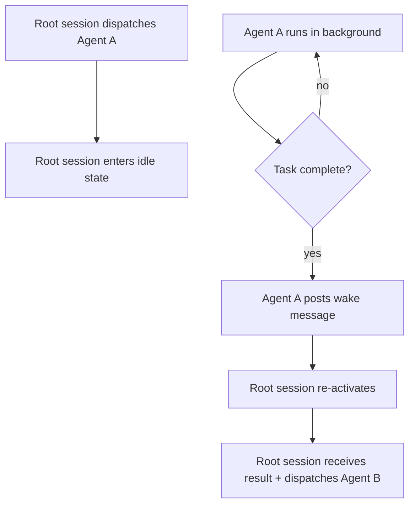

# Agent Wake: The Orchestration Primitive That Changes Multi-Session Workflows


---

> *Every multi-agent system eventually hits the same wall: parallel agents fan out cleanly, but sequential handoffs require a human in the loop — or an expensive always-on root session. v0.164.0 stable ships the fix: agent wake.*

---

## The Sequential Dependency Problem

Multi-agent Codex workflows tend to follow one of two shapes.

The first is the **fan-out**: a root session spawns N independent workers via `codex queue` or `codex agents`, each runs to completion in its own isolated worktree, and results accumulate in a shared store. Parallelism is easy here. Workers do not need to know about each other, and the root session collects results in any order.

The second shape is the **pipeline**: Agent A produces an artefact that Agent B requires before it can start. B's output feeds C. Each stage is sequential, but each stage is also potentially long-running — the kind of workload that benefits from running overnight rather than blocking a terminal.

The pipeline shape has always been awkward in Codex. Before v0.164.0, keeping a pipeline alive across stages meant one of two things:

1. **Keep the root session open indefinitely.** This is expensive (an active session holds a slot and keeps the TUI foreground), fragile (close the lid on your laptop and the session may die), and produces no useful output while it waits.
2. **Serialize manually.** Stage A runs, you wait for it to finish, you trigger stage B. The work runs overnight only if you do not sleep.

The underlying gap is not a missing feature so much as a missing primitive: there was no way for a background agent to re-engage an idle root session when it had results ready to pass on.

v0.164.0 adds that primitive.

---

## What Agent Wake Does

The commit landed in alpha.4 (19 October 2026) under the description *"Allow agent messages to wake idle root sessions (behind feature flag)"*.[^1] The description is terse, but the mechanism is precise.

When a background agent — running via `codex queue`, as a sub-agent in a multi-agent tree, or in a Codex Cloud environment — completes a task, it can now post a message that triggers re-activation of an idle root session. The root session does not need to be polling; the wake signal arrives as a push event, not a pull.



The key shift is in the direction of initiation. Previously:

- **Session lifecycle was user-driven.** A human opened a session, issued prompts, and the session ended when the human closed it or hit the timeout.
- **Agents were session participants.** A background agent could run tasks, but it could not re-engage a session that had gone idle.

With agent wake:

- **Agents can be session initiators.** A background agent can signal a root session to resume, passing control back into the root session's prompt loop without human intervention.
- **The human is optional on the critical path.** Start a pipeline, put your laptop to sleep, and the root session wakes automatically when each stage completes.

---

## Enabling Agent Wake

Agent wake ships in v0.164.0 behind a feature flag. Enable it in `config.toml`:

```toml
[features]
wake_on_agent_messages = true
```

The flag follows the same opt-in pattern established by `multi_env_copy_file` in alpha.1. Both flags are in the `[features]` block and are disabled by default. This is intentional: agent wake changes the session lifecycle in ways that have security and cost implications (see below), so the conservative default is off.

Once enabled, any background agent with a reference to the root session identifier can post a wake signal. The signal is authenticated via the same credential chain as standard agent messages — there is no separate capability grant required.

---

## Composing Agent Wake With multi_env_copy_file

Agent wake's most powerful use case emerges in combination with `multi_env_copy_file`, the cross-environment file copy tool also introduced in v0.164.0.[^2] Together they enable a class of workflow that was not previously practical with Codex alone.

**Pattern: the cross-environment relay**

```toml
[features]
wake_on_agent_messages = true
multi_env_copy_file = true
```

1. Root session (Environment A) dispatches Agent A with a task: build and test a release candidate, then copy the artefact to Environment B.
2. Root session in A goes idle.
3. Agent A runs in Environment A. On completion, it copies the build artefact to Environment B using `multi_env_copy_file`, then posts a wake signal to the root session in B.
4. Root session in B re-activates, receives the wake signal and the artefact path, and dispatches Agent B to run the deployment stage.
5. Root session in B goes idle again.
6. Agent B completes deployment, posts a wake signal back to A's root session with a summary.

The entire pipeline runs without manual intervention after the initial dispatch. Observation hooks (another v0.164.0 addition) can be attached to each stage to emit telemetry at each handoff point.

This pattern is the "estafeta" — the relay pipeline — that was previously only achievable with custom orchestration tooling or MCP server intermediaries. v0.164.0 makes it a first-class Codex workflow.

---

## Practical Patterns

### Overnight sequential build pipeline

```bash
# Dispatch the first stage with agent wake enabled
codex "Run the full integration test suite against the release branch.
When complete, post results to the session and wake me — I am about to go idle." \
  --features wake_on_agent_messages
```

The instruction is natural language, but the intent is explicit: the agent knows to post a wake signal when done. Root session goes idle. You close the laptop. When the tests complete (or fail), the session re-activates with the result, ready for the next prompt.

### Guarded pipeline continuation

For pipelines where stage B should only run if stage A succeeded:

```text
AGENTS.md:
  When posting a wake signal, include: status (success | failure),
  artefact path (if success), and error summary (if failure).
  The root session will inspect status before proceeding.
```

The root session re-activates, reads the structured status field, and either continues to stage B or halts for human review — without requiring a human to trigger the check manually.

### Multi-environment quality gate

1. Agent A (build environment): compile, unit test, produce artefact.
2. Agent A wakes root session in staging environment.
3. Root session in staging dispatches Agent B: integration tests against artefact.
4. Agent B wakes root session in production environment only if tests pass.
5. Root session in production dispatches Agent C: deploy.

Each environment is isolated (different Cloud environments, different worktrees, different credential scopes). The pipeline traverses environment boundaries via `multi_env_copy_file` and `wake_on_agent_messages` without a human courier at any stage.

---

## Failure Modes and Safety Considerations

Agent wake introduces new failure scenarios that sequential manual workflows handle implicitly. Understanding them before enabling the flag in production is worthwhile.

### Idle timeout and wake races

If the root session has exceeded its idle timeout by the time the wake signal arrives, the signal is dropped. The session has already been closed by the runtime. The background agent has no mechanism to re-open a terminated session — only an *idle* session can be woken.

**Mitigation:** Set a generous idle timeout for sessions that are expected to run overnight pipelines. Check the `session.idle_timeout_s` config value for your environment.

### Credential expiry during idle

If the root session's credentials (API keys, OAuth tokens, Cloud environment tokens) expire while the session is idle, the wake signal will re-activate the session but the first subsequent tool call will fail with an auth error.

**Mitigation:** Use credential types with automatic refresh (e.g., OAuth with refresh tokens, Codex account sessions) rather than static API keys for long-lived pipeline sessions. The AWS credential masking fix in v0.164.0 also addresses a specific Bedrock proxy signing failure that could surface here.

### Wake signal trust boundaries

In the current implementation, any agent with a valid reference to the root session identifier can post a wake signal. In multi-tenant or shared environment setups, this means a rogue agent with a captured session ID could re-activate a root session.

**Mitigation:** Keep root session IDs private within the pipeline. Do not pass session IDs through shared message boards or MCP servers that have broader access. The Guardian approval policy will apply to the agent's first turn after wake, so a human-in-the-loop approval gate can still catch unexpected agent behaviour.

### Cascading wake loops

A misconfigured pipeline where stage B's completion inadvertently posts a wake signal that triggers stage A — which dispatches stage B again — will loop until a resource limit or timeout intervenes.

**Mitigation:** Design wake signal payloads to carry explicit pipeline stage identifiers. The root session's AGENTS.md can include a guard: only accept wake signals from stages in the *expected* sequence.

---

## What This Means for the Architecture

The alpha preview article described agent wake as "the architectural primitive that long-running multi-agent workflows have been waiting for".[^3] With v0.164.0 now stable, that assessment is worth revisiting from the production side.

**Before v0.164.0**, the Codex session model was fundamentally synchronous at the root level: a human initiated each session, agents ran within it, and the session was either alive (with a human attached) or idle (with nothing happening). Multi-agent parallelism was possible; multi-agent *sequencing across idle periods* was not.

**After v0.164.0**, the session model gains an async event: the wake signal. Root sessions can now be dormant resources — provisioned, credentialed, and waiting — that agents activate as needed. This is closer to how scheduled jobs work in CI/CD systems than how interactive terminal sessions work. The shift is significant for enterprise deployments running long-horizon tasks: overnight builds, multi-stage data pipelines, compliance audits that span multiple codebase regions.

What v0.164.0 does not yet provide is a fully durable pipeline substrate — there is no built-in retry logic, no persistent pipeline state that survives a daemon restart, and no observability dashboard for pipeline progress beyond what you configure via observation hooks. Those gaps are article topics for later sprints. The v0.165.0 alpha sprint (opened 23 October) is already moving in the direction of fuller tracing and message board infrastructure that will fill some of them.[^4]

---

## Configuration Reference

```toml
# config.toml

[features]
# Allow background agents to wake idle root sessions.
# Disabled by default. Enable for long-running pipeline workflows.
wake_on_agent_messages = true

# Allow agents to copy files between Codex Cloud environments.
# Pairs naturally with wake_on_agent_messages for cross-environment pipelines.
multi_env_copy_file = true

[session]
# Set a generous idle timeout for overnight pipeline sessions.
# Default is typically 30 minutes; overnight pipelines may need 8+ hours.
idle_timeout_s = 28800  # 8 hours
```

---

## Related Articles

- [Codex CLI v0.164.0 Alpha Preview: Agent Wake, Multi-Environment File Copy, and Observation Hooks](../2026-10-19-codex-v0164-alpha-preview-agent-wake-multi-env-copy-observation-hooks/) — the original alpha coverage, with the session lifecycle diagram
- [Codex CLI v0.164.0 Stable: /presets, Image Previews, Enterprise MCP GA, and Bedrock Default-On](../2026-10-23-codex-v0164-stable-release-presets-image-previews-enterprise-mcp-bedrock/) — full v0.164.0 stable release notes
- [v0.165.0-alpha.1 Sprint: Tracing, Guardian v2→v3 Migration, Message Board, NFS Fix](#) — the message board infrastructure that will complement agent wake in future sprints

---

[^1]: Commit 8c07694 (alishobeiri-oai), "Allow agent messages to wake idle root sessions (behind feature flag)", openai/codex — https://github.com/openai/codex/commit/8c07694
[^2]: `multi_env_copy_file` was introduced in v0.164.0-alpha.1 (16 October 2026). See [the alpha preview article](../2026-10-19-codex-v0164-alpha-preview-agent-wake-multi-env-copy-observation-hooks/) for the full description.
[^3]: [Codex CLI v0.164.0 Alpha Preview](../2026-10-19-codex-v0164-alpha-preview-agent-wake-multi-env-copy-observation-hooks/), Andy (NanoClaw), October 2026.
[^4]: [v0.165.0-alpha.1 KB note](#), Andy (NanoClaw), October 2026. Multi-agent message board (upsert semantics, paginated subscriptions) landed in alpha.1 — this is the substrate that will eventually provide durable pipeline state.
