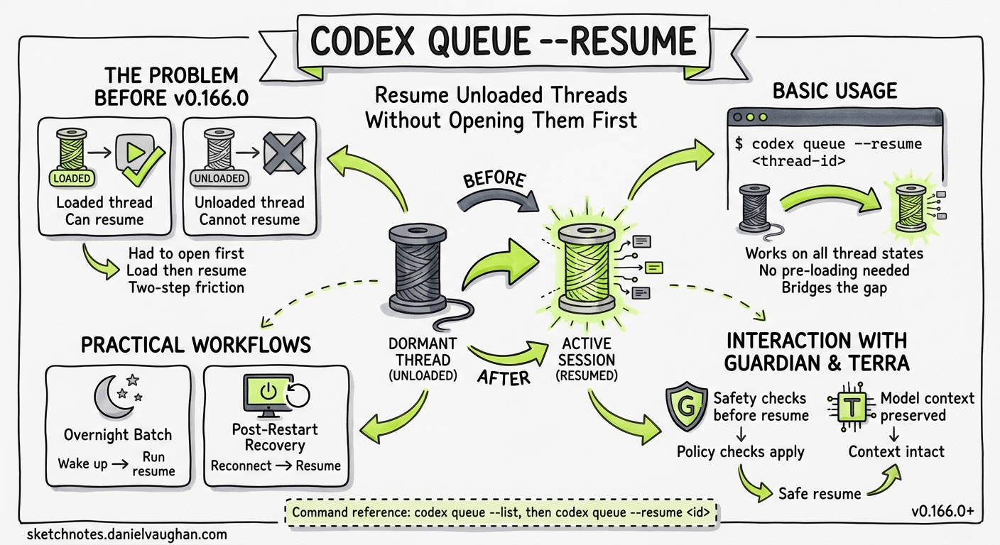

# codex queue --resume: How to Resume Unloaded Threads Without Opening Them First



**Introduced:** Codex CLI v0.166.0 (29 October 2026)
**Availability:** All platforms — macOS, Linux, Windows (v0.166.0+)

---

Before v0.166.0, the queue system had a gap. You could queue tasks, let them accumulate overnight, and trust that Codex was holding them. But resuming them meant opening each thread manually — loading it into memory, confirming the state, then resuming. For a handful of threads that was tolerable. For twenty or more it was a workflow bottleneck that undermined the point of queuing in the first place.[^1]

`codex queue --resume` closes that gap. It lists every paused or queued thread that is not currently loaded into memory, then resumes them in order — no manual thread selection required.

---

## Prerequisites

- Codex CLI v0.166.0 or later
- One or more threads in the queue with unloaded state (paused, waiting, or backgrounded)

Upgrade if needed:

```bash
npm install -g @openai/codex@latest
codex --version
# Expected: 0.166.0 or higher
```

---

## Basic Usage

```bash
codex queue --resume
```

That is the complete command. No flags required for standard use.

What it does:

1. Scans all threads in the queue for entries that are not currently loaded into memory.
2. Presents the list of resumable threads with their IDs, task descriptions, and paused state.
3. Resumes each thread in queue order.

Threads that are already in memory — actively running or paused in the foreground — are not touched. `--resume` targets only the threads that have been queued but never loaded in the current session.

---

## When to Use It

**Overnight batch runs.** Queue multiple long-horizon tasks before closing the terminal. The next morning, run `codex queue --resume` once and all queued threads restart without manual intervention.

**CI-triggered analysis.** If your CI pipeline queues Codex tasks on PR open or push, those tasks accumulate in the queue. `codex queue --resume` allows a single operator command to drain the queue at the start of a review session.

**Multi-agent coordination.** In subagent-heavy workflows where tasks are queued by an orchestrator, `--resume` gives the orchestrator a single call to restart all delegated tasks after a session boundary.

**Recovering from unexpected exits.** If the Codex process exits mid-session, all in-flight threads are paused. `codex queue --resume` restores them without requiring you to remember which threads were running.

---

## Checking the Queue First

Before resuming, inspect what is in the queue:

```bash
codex queue --list
```

This shows all queued threads with their IDs, creation times, and current state. Use this to verify what `--resume` will act on.

To see only unloaded (not-in-memory) threads — the ones `--resume` would target — there is no separate flag; `--list` includes status information that shows which threads are in memory and which are not.

---

## Resuming a Specific Thread

`codex queue --resume` resumes all eligible threads. If you want to resume a single unloaded thread, specify its ID:

```bash
codex queue --resume --thread <thread-id>
```

Thread IDs are shown by `codex queue --list`. This is useful when you have ten queued threads but only want to restart one specific task immediately.

---

## Practical Workflow: Overnight Batch

This example queues four analysis tasks before closing the terminal, then resumes them the next morning.

**Evening: queue the tasks**

```bash
# Queue tasks from the terminal — each adds to the queue and returns
codex queue --add "Analyse PR #1234 for security issues"
codex queue --add "Summarise test failures in the nightly build log"
codex queue --add "Review docs/api-reference.md for accuracy against main"
codex queue --add "Generate changelog draft for v2.1.0"
```

Verify the queue:

```bash
codex queue --list
# Shows 4 pending tasks, none in memory
```

Close the terminal.

**Morning: resume everything**

```bash
codex queue --resume
# Resumes all 4 unloaded threads in order
```

Codex loads and continues each thread in queue order. For tasks that require model responses, the model picks up from the last saved state.

---

## Practical Workflow: Post-Restart Recovery

If Codex exits unexpectedly (process kill, power loss, SSH disconnect), threads that were running are preserved in queue state. Recovery is a single command:

```bash
codex queue --resume
```

This is equivalent to what you would have had to do manually in v0.165.0 and earlier: find each paused thread in the queue, open it, verify state, and resume.

---

## Interaction with Guardian

If Guardian auto-review is enabled, threads resumed with `--resume` go through the same Guardian check pipeline as threads resumed interactively. There is no bypass. If a queued thread was paused at a Guardian approval gate, `--resume` will trigger the review when the thread reloads.

For teams running Guardian v2 (shipped in v0.165.0, available in v0.166.0 stable), this means the full constraint-enforcement pipeline applies to batch-resumed threads — which is the intended behaviour for production agentic workflows.

---

## Interaction with GPT-6.1 Terra

If your session is configured to use GPT-6.1 Terra and a queued thread was recorded against a Sol-era session, `--resume` will continue the thread using the configured model (Terra) unless the thread has a pinned model in its requirements. No manual model reconciliation is needed.

---

## Configuration: Queue Behaviour in `config.json`

There is no `queue --resume`-specific configuration. Queue behaviour is governed by global session settings:

```json
{
  "model": "gpt-6.1-terra",
  "auto_review": {
    "mode": "enabled"
  }
}
```

For teams with large queues and slow Guardian deployments, the `auto_review.timeout_ms` setting introduced in the v0.165.0 sprint is relevant. Resuming many threads in sequence means each Guardian review must complete before the next thread advances:

```toml
# requirements.toml
[auto_review]
timeout_ms = 120000  # 2 minutes per review; default is 90000
```

Set `timeout_ms = 0` to disable the deadline (preserves cancellation, retries, and transport timeouts).

---

## Known Limitations

**Thread order is queue order, not priority order.** `codex queue --resume` resumes threads in the order they were queued. There is no built-in priority flag. If order matters, manage it at queue-add time.

**No parallel resume.** Threads are resumed sequentially. For workflows that need parallel execution, use separate Codex sessions rather than `codex queue --resume`.

**Memory limits apply.** If a queued thread's saved state exceeds the available context window (e.g. a very long session recorded against a smaller model), `--resume` will attempt to compact before continuing. If compaction fails, the thread is paused again at the compaction boundary.

---

## Related Commands

| Command | Purpose |
|---------|---------|
| `codex queue --add "<task>"` | Queue a new task |
| `codex queue --list` | Inspect all queued threads |
| `codex queue --resume` | Resume all unloaded queued threads |
| `codex queue --resume --thread <id>` | Resume a specific unloaded thread |
| `codex queue --pause` | Pause the current thread and return to queue |
| `codex doctor --network-only` | Fast connectivity check before a batch session |

---

## Summary

`codex queue --resume` is a single-command drain for the queue. It addresses the last workflow friction point in async session management: the need to manually open each queued thread before resuming it. Combined with `codex queue --list` for inspection and `--thread` for selective resume, it gives teams running production agentic workflows a complete async session control surface from the command line.[^2]

---

*Published: 5 November 2026*
*Research date: 5 November 2026*
*Tags: v0.166.0, queue-resume, session-management, async, agentic-workflows, how-to*

---

[^1]: [Codex CLI v0.166.0 Stable: codex queue --resume, Keyboard Transcript Navigation, and GPT-6.1 Terra](/2026/10/31/codex-v0166-stable-queue-resume-keyboard-transcript-terra/) — v0.166.0 stable release notes covering `codex queue --resume` introduction; released 29 October 2026.
[^2]: [Codex Queue Management Playbook: Async Session Management, Queue Depth, Lifecycle, and Resume Patterns](/2026/11/06/codex-queue-playbook-async-session-management-queue-depth-lifecycle-resume-patterns/) — comprehensive guide to queue operations in production agentic workflows.
