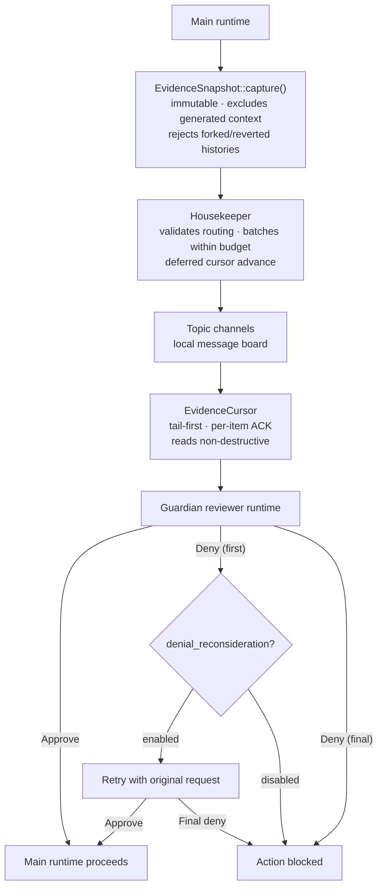

# Guardian v3's Evidence Pipeline: Snapshots, Cursors, and Housekeeping in Codex CLI

**Merged:** Four PRs on 5 November 2026 — #59669, #59670, #59671, #59659
**Affects:** Codex CLI v0.168.0 and later (PRs merged after v0.167.0 stable cutoff)
**Authors:** felixxia-oai (evidence pipeline), jif (denial reconsideration)

---

Guardian v2 shipped with Codex CLI v0.165.0 and introduced the idea of a dedicated reviewer runtime — a separate model context that evaluates actions before they are executed. It was a meaningful step forward from the inline policy checks of earlier versions. But it had a structural problem: evidence about what the model had actually done was consumed in a single sweep, without durable snapshots, incremental tracking, or topic-based routing. If the reviewer missed something, there was no replay. If the evidence stream was large, the reviewer could exceed its model budget on a single pass.

Guardian v3 fixes this. On 5 November 2026, four PRs merged in rapid succession to implement a complete evidence capture and routing pipeline. Together they define the architecture that will underpin Codex CLI's safety layer for the foreseeable future.

---

## Background: The Local Message-Board Model

Since the `codex-guardian-v3` crate note first appeared in the codebase on 23 October 2026, the design has used what internal notes describe as a "local message-board model." Evidence is not passed directly from the main runtime to the reviewer. Instead, it is written to topic channels on a local message board, and the reviewer reads from those channels in its own time, at its own pace.

This decoupling is the key architectural decision in v3. It means:

- The main agent runtime is never blocked waiting for the reviewer.
- The reviewer can process evidence incrementally, acknowledging items as it goes.
- Topic channels allow different classes of evidence (tool calls, approvals, history snapshots) to be routed separately, so the reviewer can prioritise by type.

The four November PRs implement the three layers of this model: **capture** (EvidenceSnapshot), **reading** (EvidenceCursor), and **routing** (Housekeeper), plus a parallel change to how terminal denials are retried (denial reconsideration).

---

## Layer 1 — EvidenceSnapshot: Immutable Capture

**PR #59669** — *Add original-history evidence snapshots for Guardian v3*
**Author:** felixxia-oai

The first layer is `EvidenceSnapshot::capture`. When Guardian v3 needs to evaluate an action, it does not operate on the live session history. Instead, it takes an immutable snapshot of the original history at that moment — messages, tool activity, and approvals as they existed when the snapshot was taken.

Three constraints govern what goes into a snapshot:

1. **Generated context is excluded.** System-injected content, compaction artefacts, and synthetic context added by the runtime are stripped before snapshotting. The reviewer sees only what originated from the model or the user.

2. **Root-history ordinals are preserved.** Each snapshot records the ordinal position of its contents in the root history, so the reviewer can reason about the temporal relationship between events even after later turns have been added.

3. **Forked or reverted histories are rejected.** If the session history has been forked (branched from a saved state) or reverted (rolled back via the undo mechanism), `EvidenceSnapshot::capture` will refuse to proceed. This prevents the reviewer from evaluating evidence that may not reflect the actual execution path.

The immutability guarantee is the critical property. Because the snapshot is taken at a fixed point and cannot be modified, the reviewer's evaluation is always over a consistent, well-defined slice of history — not a moving target.

---

## Layer 2 — EvidenceCursor: Incremental Reading

**PR #59670** — *Capture Guardian evidence incrementally with explicit acknowledgements*
**Author:** felixxia-oai

The second layer solves the budget problem. If a session has accumulated many tool calls and approval events, a reviewer that tries to process all of them in one pass will hit the model's tool-output budget. The `EvidenceCursor` enables incremental consumption.

Key properties:

- **Tail-first initialisation.** A new cursor starts at the tail of the evidence stream — it does not backfill history that existed before it was created. This is intentional: Guardian v3 is designed to monitor ongoing activity, not to audit the entire prior history of a session.

- **Per-item acknowledgement.** The cursor tracks which items have been processed and confirmed by the reviewer. An item is not marked as consumed until the reviewer explicitly acknowledges it. This prevents silent data loss if the reviewer terminates mid-read.

- **Partial acknowledgements are supported.** The reviewer does not need to acknowledge all items in a batch before writing its evaluation. If a batch contains ten tool calls and the reviewer can confidently evaluate seven of them, it can acknowledge those seven and leave three for the next read cycle.

- **Reads leave progress unchanged.** Reading items from the cursor does not advance the cursor's position. Only acknowledgements advance it. This means the reviewer can read the same items multiple times — useful when it needs to cross-reference a tool call against an earlier approval event before making a decision.

---

## Layer 3 — Housekeeper: Routing Evidence to Topic Channels

**PR #59671** — *Add evidence housekeeping for Guardian v3*
**Author:** felixxia-oai

The third layer is the `Housekeeper`. It sits between the evidence capture layer and the message board, taking captured snapshots and routing them into the correct topic channels.

Routing logic:

- The Housekeeper uses an isolated reviewer runtime — it does not share the main agent's model context.
- Evidence is batched before routing to stay within the model's tool-output budget. The batch size is determined by the budget constraint, not by an arbitrary fixed limit.
- Routing is validated before writing: the Housekeeper will not commit a batch to a topic channel if the routing decision itself is uncertain. This prevents evidence from being written to the wrong channel and missed by the reviewer.
- **Cursor advancement is deferred.** The Housekeeper only advances the evidence cursor after all writes for a batch have succeeded. If any write fails, the cursor stays at its previous position and the batch is retried on the next cycle.

The validation-before-write and deferred-cursor-advance properties together give the pipeline an at-least-once delivery guarantee for evidence routing. Under normal conditions each item is routed exactly once, but under failure conditions items may be routed again rather than dropped.

---

## Denial Reconsideration: Retrying Terminal Denials

**PR #59659** — *Resample Guardian denials with the original request*
**Author:** jif

The fourth PR is architecturally separate but practically related. It introduces a `guardian_denial_reconsideration` feature flag that changes how Guardian handles terminal denials — cases where the reviewer returns a final "do not proceed" verdict.

Previously, a terminal denial was final. The model's request was blocked and no retry occurred.

With denial reconsideration enabled:

- The first terminal denial triggers a **single retry** using the unchanged inference request — not a reformulated version, the exact original request.
- The model's provisional output for the denied action is **buffered** while the retry is in flight. If the retry succeeds, the buffered output is released. If it fails or times out, the original denial stands and the buffered output is discarded.
- The old `experimental_denial_reconsideration_prompt` configuration key is removed. The retry no longer uses a custom prompt — it uses the original inference request directly. This eliminates a surface for prompt-injection attacks against the reconsideration path.

The intent is to handle cases where Guardian's first evaluation was produced under degraded conditions — a timeout, a partial context window, or a reviewer that was temporarily resource-constrained. One retry with the original request is enough to distinguish a genuine denial from a transient evaluation failure.

---

## The Complete Picture

The four PRs together define a coherent pipeline:

This is a significant maturation from Guardian v2. The reviewer now operates against a durable, structured evidence stream rather than consuming a live history snapshot in a single pass. The pipeline has explicit delivery guarantees, budget awareness, and a failure-recovery path for terminal denials.

---

## What This Means for Agentic Workflows

For users running long autonomous sessions, the practical implications are:

**More reliable safety evaluation.** The snapshot model means Guardian's reviewer always evaluates consistent evidence. It cannot see a half-written tool call or a history that is in the middle of being compacted.

**Less interference with throughput.** The decoupled, incremental pipeline means the reviewer is less likely to block the main runtime. Evidence is processed in the background, within budget, without the main agent waiting.

**Clearer denial semantics.** With denial reconsideration, a single denied action is no longer necessarily a workflow-stopper. If the denial was produced under degraded conditions, Codex will retry once before surfacing the block to the user.

**Guardian v3 evidence pipeline is not in v0.167.0 stable.** The four PRs (#59659, #59669–#59671) were merged on 5 November 2026 — after the v0.167.0 stable cut (highest included PR: #58757). v0.167.0 (6 November 2026) is now stable but contains only the Guardian v3 elastic budgeting work (PRs #58123–#58454). Watch the v0.168.0 release for the first stable exposure of the evidence pipeline.

---

## Related Reading

- [Inside the Black Box: Codex CLI v0.165.0's Observability Sprint](/2026/10/26/v0165-observability-sprint-tracing-streaming-tool-dispatch-guardian-v2/) — Guardian v2 context
- [Guardian v2 vs. GPT-6.1 Sol: Enforcing AGENTS.md at the System Level](/2026/10/29/guardian-v2-vs-gpt61-sol-regression-constraint-enforcement-system-level-fix/)
- [v0.167.0 Sprint Preview: The Rust TUI Rewrite and the Reliability Debt OpenAI Needs to Clear](/2026/11/03/v0167-sprint-preview-rust-tui-rewrite-reliability-debt-what-openai-needs-to-ship/)

---

*Source PRs: [#59669](https://github.com/openai/codex/pull/59669), [#59670](https://github.com/openai/codex/pull/59670), [#59671](https://github.com/openai/codex/pull/59671), [#59659](https://github.com/openai/codex/pull/59659)*
