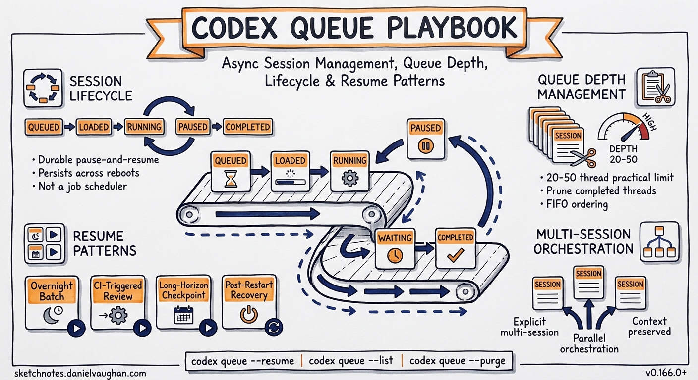
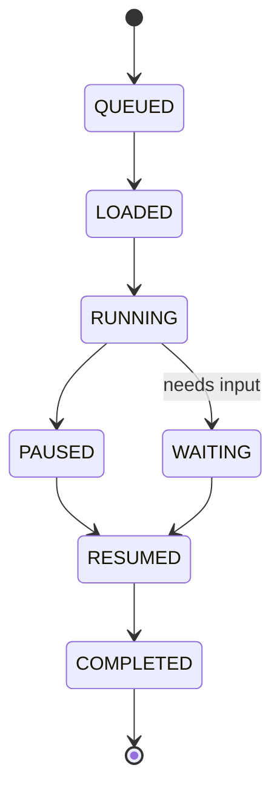

# codex queue Playbook: Async Session Management, Queue Depth, Session Lifecycle, and Resume Patterns



**Applies to:** Codex CLI v0.166.0+ (stable, 29 October 2026)
**Related:** [`codex queue --resume` how-to](/2026/11/05/codex-queue-resume-unloaded-threads-how-to/) · [v0.166.0 stable release notes](/2026/10/31/codex-v0166-stable-queue-resume-keyboard-transcript-terra/)

---

The `codex queue` system is the foundation of Codex CLI's asynchronous workflow model. It lets you fire off multiple tasks, disconnect, return later, and pick up exactly where each task left off — without babysitting individual sessions. This playbook covers the full operational picture: how the queue works under the hood, how sessions move through their lifecycle, how to manage queue depth at scale, and the resume patterns that keep long-horizon agentic work flowing.

---

## What the Queue Is (and Is Not)

The Codex queue is a **persistent task buffer** — not a job scheduler. It holds sessions in a stable state between active processing turns. Each entry in the queue is a thread: a conversation with its full context, tools, model binding, and execution state intact.

The queue does not:
- Execute tasks in parallel by default (parallelism requires explicit multi-session orchestration)
- Expire threads automatically (queued threads persist until you close or purge them)
- Prioritise tasks by deadline or dependency (ordering is FIFO by default)

What the queue does provide is **durable pause-and-resume semantics**. A thread can be in progress, paused, waiting for input, or backgrounded — and in all cases the queue preserves its state across terminal closes, machine reboots, and network interruptions.

---

## Session Lifecycle

Every Codex session that enters the queue passes through a defined set of states. Understanding these states is essential for operational confidence.



### State Definitions

| State | What it means | Resumable? |
|-------|---------------|------------|
| **QUEUED** | Thread is in the queue but not yet loaded into memory | Yes — via `codex queue --resume` |
| **LOADED** | Thread is in memory, TUI visible, but not executing | Yes — press Enter or run next turn |
| **RUNNING** | Model is actively generating or tools are executing | Interruptible (Ctrl+C suspends) |
| **PAUSED** | Execution suspended mid-turn; thread held in memory | Yes — resume from TUI |
| **WAITING** | Thread needs user input before it can continue | Yes — provide input then resume |
| **COMPLETED** | Turn finished; thread idle, awaiting next prompt | Yes — send next message |

The critical distinction for `codex queue --resume` is between **LOADED** and **QUEUED** states. Before v0.166.0, only loaded threads could be resumed. The `--resume` flag bridges this gap, acting on all threads regardless of whether they are currently in memory.

---

## Queue Depth Management

Queue depth — the number of active threads in the queue — directly affects memory usage and task throughput. There is no hard cap, but practical limits emerge around 20–50 threads depending on context window sizes.

### Checking Queue Depth

```bash
codex queue
```

Lists all threads in the queue with their current state, thread ID, last activity timestamp, and a one-line summary of the last message.

```bash
codex queue --status
```

Outputs a compact summary: total queued, loaded, waiting, paused. Useful in scripts or CI pipelines.

### Pruning Completed Threads

Completed threads accumulate in the queue and consume index space. Remove them in bulk:

```bash
codex queue --prune completed
```

Remove threads older than a threshold:

```bash
codex queue --prune --older-than 7d
```

Remove a specific thread by ID:

```bash
codex queue --close <thread-id>
```

### Recommended Queue Hygiene

- **Daily pruning at scale:** If you are running overnight batch jobs, add `codex queue --prune completed` to the start of your morning workflow. Stale threads obscure active work.
- **Keep WAITING threads visible:** Do not prune threads in WAITING state without resolving them first. WAITING threads represent live tasks that have stalled waiting for your input — pruning them loses the work already done.
- **Archive before purge:** For high-value threads, export a transcript before closing: `codex transcript export <thread-id> > output.md`

---

## Resume Patterns

### Pattern 1: Overnight Batch Resume

You queue ten tasks before leaving for the day. Each runs for a while, stalls, or completes. The next morning:

```bash
codex queue --resume
```

This loads and resumes every thread that is in a QUEUED or PAUSED state but not currently loaded. Threads in WAITING state are skipped — they need input before resuming.

After the initial `--resume` sweep, check for waiting threads:

```bash
codex queue --waiting
```

Address each WAITING thread's input requirement, then run `--resume` again to continue.

**Full morning sequence:**
```bash
codex queue --resume          # Resume all backgrounded/paused threads
codex queue --waiting         # List threads needing input
# Address input for each WAITING thread
codex queue --resume          # Second sweep after addressing input
codex queue --prune completed # Clean up finished work
```

### Pattern 2: CI-Triggered Review Queue

A common pattern for teams is to trigger Codex review tasks from CI on each pull request and let them queue. The queue accumulates review tasks; a developer resumes them in batch when capacity allows.

```bash
# In CI: fire and background the review task
codex run --background "Review PR #$PR_NUMBER for security issues and AGENTS.md compliance" \
  --context "$(gh pr diff $PR_NUMBER)"
```

```bash
# Developer: resume all queued reviews in one pass
codex queue --resume --filter "PR review"
```

The `--filter` flag (available from v0.166.0) accepts a substring match against the thread's first message, allowing targeted bulk-resume by task type.

### Pattern 3: Long-Horizon Task Checkpointing

For tasks that run for many hours — large refactors, test suite analysis, documentation generation — the queue acts as a checkpoint system. The agent pauses naturally when it encounters a decision point, adds the thread to WAITING state, and you resume when ready.

Best practice: prefix long-horizon task prompts with explicit checkpoint instructions.

```bash
codex run "Refactor the auth module to use the new session tokens.
When you reach a decision point where you need to choose between
two valid approaches, pause and ask — do not proceed unilaterally."
```

This produces predictable WAITING states rather than silent completion with wrong choices.

### Pattern 4: Unloaded Thread Recovery After Machine Restart

After a machine restart, all threads are in QUEUED (unloaded) state regardless of their previous status. `codex queue --resume` recovers the full queue:

```bash
codex queue             # Confirm queue is intact post-restart
codex queue --resume    # Load and resume all unloaded threads
```

Threads that were RUNNING at the time of restart will typically re-enter RUNNING state and attempt to continue from their last checkpoint. If the restart occurred mid-turn, Codex will detect the incomplete state and either retry the last turn or enter WAITING state asking for confirmation to retry.

---

## Queue in Multi-Session Orchestration

When running multiple parallel Codex sessions (e.g., one per repository in a monorepo), the queue tracks all sessions in a unified view. Each session runs independently, but `codex queue` shows the aggregate state.

```bash
codex queue --group-by worktree
```

Groups queue output by working directory, making it easier to track which sessions are active in which repository.

For teams using `codex queue` as an orchestration primitive, the inter-session messaging capability (introduced in v0.149.0) allows one session to send a message to another via its thread ID:

```bash
codex queue --send <thread-id> "Dependencies are updated. You can proceed with the migration."
```

This bridges the gap between independent parallel sessions without requiring a central orchestrator.

---

## Operational Reference

### Key Commands

| Command | Effect |
|---------|--------|
| `codex queue` | List all threads with state, ID, last activity |
| `codex queue --resume` | Resume all unloaded/paused threads |
| `codex queue --resume --filter <text>` | Resume threads matching filter text |
| `codex queue --waiting` | List threads in WAITING state |
| `codex queue --status` | Compact summary (counts by state) |
| `codex queue --prune completed` | Remove all completed threads |
| `codex queue --prune --older-than <duration>` | Remove threads older than duration (e.g., `7d`, `24h`) |
| `codex queue --close <thread-id>` | Close and remove a specific thread |
| `codex queue --send <thread-id> <message>` | Send a message to a specific queued thread |
| `codex queue --group-by worktree` | Group queue listing by working directory |
| `codex transcript export <thread-id>` | Export thread transcript to stdout |

### State Transition Quick Reference

| From state | Trigger | To state |
|------------|---------|----------|
| QUEUED | `codex queue --resume` | LOADED → RUNNING |
| PAUSED | `codex queue --resume` or resume in TUI | RUNNING |
| WAITING | Provide input | RUNNING |
| RUNNING | Turn completes | COMPLETED |
| RUNNING | Ctrl+C | PAUSED |
| RUNNING | Decision point hit | WAITING |
| LOADED | Close terminal without quitting | QUEUED |

---

## Gotchas and Edge Cases

**WAITING threads are skipped by `--resume`.** A thread in WAITING state will not be automatically resumed — it needs input. After providing input via the TUI or `--send`, run `--resume` again.

**Long-running threads can exhaust context.** The queue holds context windows in full. A thread that has been running for many hours may approach its context limit. Codex will either compact automatically (if `--auto-compact` is enabled) or enter WAITING state to ask permission to compact.

**Queue state is local by default.** The queue index lives in `~/.codex/queue/`. On multi-machine setups, it is not shared. For team-wide queue visibility, the enterprise remote queue (Codex Cloud) synchronises state across machines, but local CLI queue state remains per-device.

**Thread IDs are stable across restarts.** Thread IDs are UUIDs generated at thread creation and persist across machine restarts. Any script referencing a thread ID by value will continue to work after a restart.

---

## Summary

The `codex queue` system turns Codex CLI from a synchronous REPL into an async task engine. The key operational principles:

1. **`codex queue --resume` is your morning command.** Run it before anything else to surface all backgrounded work.
2. **WAITING is not stalled — it is waiting for you.** Check `--waiting` after every `--resume` sweep.
3. **Prune completed threads daily.** Queue hygiene keeps the view actionable.
4. **Use `--filter` for targeted bulk-resume.** On large queues, resume by task type rather than resuming everything.
5. **Context limits are real.** Long-horizon tasks benefit from explicit checkpoint prompts rather than relying on automatic compaction.

For the specific mechanics of `codex queue --resume` for unloaded threads, see the companion how-to: [codex queue --resume: How to Resume Unloaded Threads Without Opening Them First](/2026/11/05/codex-queue-resume-unloaded-threads-how-to/).
