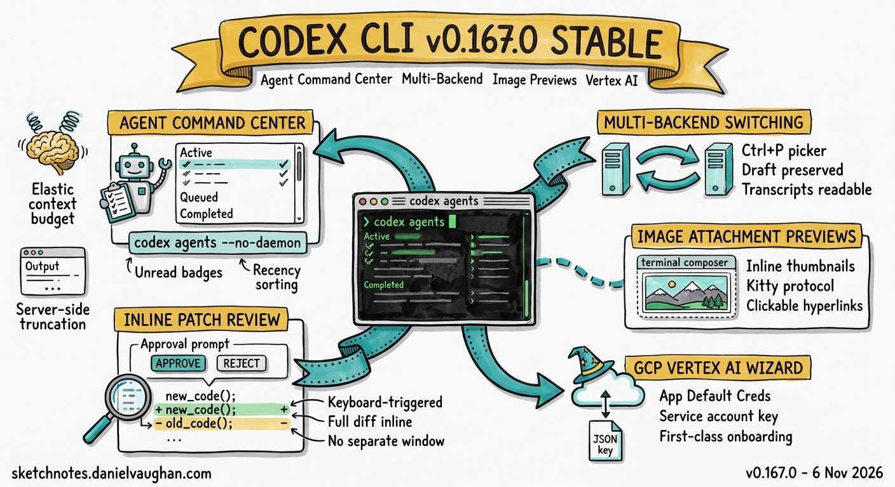

# Codex CLI v0.167.0 Stable: Agent Command Center, Multi-Backend Switching, Image Attachments, and GCP Vertex AI Wizard



**Release date:** 6 November 2026, 01:40 UTC
**Version:** v0.167.0 stable
**Previous stable:** v0.166.0 (29 October 2026, 19:47 UTC)
**Sprint duration:** 7 days, 6 hours (v0.166.0 stable to v0.167.0 stable — multiple alpha series including v0.167.x and v0.168.0-alpha)

---

Codex CLI v0.167.0 reaches stable after one of the longest sprint windows in recent memory — eight days spanning a parallel alpha series and 100+ merged PRs. The release centres on five headline changes: a new **Agent Command Center** TUI for managing concurrent agent tasks, **multi-backend session switching** directly from the resume picker, **local image attachment previews** in the composer, an integrated **GCP Vertex AI setup wizard**, and **inline patch review** during approval prompts. Supporting these are substantial Guardian v3 context budgeting improvements, bounded Code Mode output with server-side truncation, managed network permission constraints for AGENTS.md, and a cluster of UX fixes across keyboard handling, network approval prompts, and realtime transcription.

For coverage of the Guardian v3 evidence pipeline work that merged during the alpha sprint but landed after the v0.167.0 stable cut (and ships in v0.168.0), see [Guardian v3: Evidence Pipeline, Snapshots, Cursors, and Housekeeping](/2026/11/05/guardian-v3-evidence-pipeline-snapshots-cursors-housekeeping/).

---

## What Shipped in Stable

### Agent Command Center

The most architecturally significant addition in v0.167.0 is the **Agent Command Center** — a TUI panel that surfaces concurrent and background agent tasks in a single navigable view. It is accessible via:

```bash
codex agents --no-daemon
```

The command center lists active, queued, and completed agent tasks across all sessions. Unread results are marked visually; the session picker similarly flags sessions with unread output. This closes a workflow gap that has grown more acute as teams use Codex CLI for orchestrated multi-agent work: previously, there was no consolidated view of what agents were running, what had completed, or what was awaiting review.

Key behaviour details from the PRs (#58238, #58239, #58263, #58264):

- **Embedded sessions** are fully supported — the command center works within app-server embedded deployments, not only standalone CLI usage.
- **Task tools** (the internal task-management primitives) are enabled for embedded sessions, unifying the task surface between CLI and app-server modes.
- **Unread acknowledgement** — viewing a session transcript marks it as read; the picker badge clears.
- **Recency sorting** — agent center tasks are sorted by recency within status groups (#58714), so the most recently active items surface at the top of each category.

For teams running overnight batch pipelines or parallel code-review agents, the command center provides the visibility layer that the queue system has been missing since it shipped in v0.164.x.

### Multi-Backend Session Switching

v0.167.0 enables **switching between connected backends directly from the TUI session picker**, without losing draft prompts (#58280, #58457, #58713). Previously, moving from one backend to another required exiting the current session and re-entering with a different connection. Draft text in the composer would be lost.

The new behaviour:

1. Open the in-app resume picker (`Ctrl+P` or the picker keybinding).
2. Navigate to a session on a different backend (e.g. switching from a local executor to a cloud-hosted session).
3. Select it — the backend connection switches while the current draft is preserved.

Sessions that cannot resume (due to backend unavailability or expiry) remain readable: their transcripts are accessible and an editable prompt can be prepared for continuation in a new session (#58202). This prevents the situation where a failed reconnect left a session's history unreachable.

Backend naming and navigation helpers were added alongside this work (#58722), making it easier to identify backends by name in the picker rather than by raw connection identifiers.

### Local Image Attachment Previews

The TUI composer now **previews local image attachments inline** on terminals that support it (#58261). When an image file is attached to a prompt, a thumbnail is rendered in the composer before submission. After the image appears in the conversation transcript, the file path is rendered as a **clickable hyperlink** that opens the original image (#58446).

Terminal support: thumbnails use the Kitty graphics protocol. Rex terminals are now detected alongside the existing Kitty terminal detection, with the graphics protocol enabled for both (#58270). On terminals without graphics support, the attachment is shown as a file reference without a visual preview — existing behaviour is preserved.

This is the most user-visible TUI change in the v0.167.0 cycle for developers who routinely attach screenshots, diagrams, or reference images to Codex prompts. The image → review → prompt loop previously required mentally tracking which file was attached; the inline preview removes that cognitive overhead.

### GCP Vertex AI Setup Wizard

The TUI onboarding flow now includes a **Google Cloud Vertex AI setup wizard** (`gcp_setup_wizard` feature flag, #57857, #58427). It is accessible under "Sign in another way" in the provider selection screen.

The wizard supports two credential paths:

1. **Application Default Credentials (ADC)** — for developers who already have `gcloud auth application-default login` configured. The wizard detects existing ADC and confirms the active project.
2. **Service account credential file** — for environments where ADC is unavailable (CI, containers, remote VMs without the `gcloud` CLI). The wizard prompts for the path to a `.json` service account key and validates it before saving.

Both paths result in Vertex AI being available as a selectable provider in the model picker, with the same GPT-6.1 and o-series model catalogue as the OpenAI API path. Alternative sign-in methods are now grouped in a submenu (#58427), decluttering the top-level sign-in screen.

For enterprise teams running Codex CLI inside GCP infrastructure — particularly those subject to data residency requirements that make direct OpenAI API calls problematic — this removes the previously manual TOML configuration step and makes Vertex AI a first-class onboarding option.

### Inline Patch Review During Approval Prompts

When Codex CLI presents an approval prompt for a file modification, v0.167.0 allows **expanding the full patch diff inline** without leaving the approval context (#58281). Previously, reviewing the proposed change required either accepting it on trust (relying on the summary in the prompt) or opening the file in a separate pane.

The expansion is keyboard-triggered from the approval prompt itself. The diff renders with the same syntax as the standard transcript patch view. After reviewing, the user accepts or rejects without navigating away.

This matters most for users running Codex CLI in `--approval-policy=never-auto` mode, where every file write requires explicit confirmation. The friction of reviewing patches without inline diff has been a consistent complaint in that configuration; this change makes the approval loop usable for detailed code review without a separate terminal window.

### System Proxy Support

macOS and Windows system proxy settings can now be used by Codex CLI via an opt-in in `/experimental` (#58157). When enabled, the CLI reads the OS-level proxy configuration and routes outbound connections accordingly. This is relevant to enterprise and corporate network environments where all outbound traffic must pass through an authenticated proxy.

The feature remains experimental in v0.167.0 — it requires opt-in and may interact with custom network permission rules under `permissions.network`.

---

## Guardian v3: Elastic Budgeting and Context Preparation

v0.167.0 ships the most significant batch of Guardian v3 improvements since the system was introduced. The theme is **elastic context budgeting** — ensuring Guardian has the right amount of context to make accurate review decisions without exceeding model context limits.

Key changes:

| PR | Change |
|----|--------|
| #58123 | Validated elastic section budget configuration |
| #58388 | Whole-entry elastic allocation for Guardian context |
| #58444 | Cap Guardian context entries before elastic allocation |
| #58454 | Elastic budgeting for Guardian context preparation |
| #58071 | Share the Guardian context delivery token limit |

The practical effect: Guardian review quality improves for long-running sessions with large context windows, where previously the context preparation layer could either over-allocate (hitting limits) or under-allocate (producing lower-quality review decisions). The elastic model adjusts allocation based on what is available after higher-priority context elements are placed.

Additional Guardian changes:

- **Direct Guardian review of recorded exec calls** (#58028) — Guardian can now review shell command calls captured in recordings, not only live tool use.
- **Native tool-call evidence preserved through Guardian review** (#58040) — evidence from native tool calls is no longer discarded during the review pipeline.
- **Experimental Guardian review for injected thread commands** (#58119) — opt-in review for commands injected into threads via the host API, relevant to MCP-driven and app-server orchestration patterns.
- **Adaptive serving assessments** (#58075) — Guardian uses serving assessments (lighter-weight checks) adaptively rather than always running full review, reducing latency for low-risk operations.
- **PreToolUse hooks before Guardian policy checks** (#58368) — the hook execution order is corrected; hooks now run before Guardian checks rather than after.

---

## Bounded Code Mode Output

v0.167.0 completes the bounded Code Mode output work that began in the alpha sprint (#57848, #57850, #57870, #58122, #58125, #58159):

- **Server-side truncation** for Code Mode sessions is now the default behaviour. When a Code Mode session produces output exceeding the configured limit, truncation happens on the server side before the output reaches the client.
- **Host output truncation** (a client-side complement) is behind a feature flag for staged rollout.
- **Negotiated truncation** — the client and server negotiate the truncation policy at session start, allowing different limits for different deployment configurations.

The practical effect: long-running Code Mode sessions that previously caused memory and context problems — particularly overnight agents running shell commands with verbose output — now have a principled output bound rather than relying on client-side filtering after the fact.

---

## Managed Network Permissions in AGENTS.md

The `permissions.network` block in `AGENTS.md` now supports **managed network requirement constraints** (#58182). This extends the existing network permission model to allow hosts to declare required network configurations that agents must satisfy.

The app-server README covers the new `[permissions.network]` block and `prompt-user` command rules that require fresh human approval at runtime rather than relying on cached policy decisions. This is relevant to enterprise deployments that need to enforce network access controls as part of their compliance posture — Codex CLI can now declare and validate those controls as part of the AGENTS.md configuration layer rather than requiring out-of-band enforcement.

---

## MCP and Plugin Improvements

- **Per-chat MCP connection leases** (#57978) — shared MCP connections now maintain per-chat leases, preventing a chat teardown from closing an MCP connection still in use by another chat.
- **MCP adapter for message-board tools** (#58341) — an internal MCP adapter for message-board tools, relevant to multi-agent coordination patterns.
- **Apps catalog discovery before tool inventory** (#58352) — Apps catalog can be discovered before the initial MCP tool inventory completes, reducing startup latency for sessions with many plugins.
- **Scoped host metadata hooks for MCP tool requests** (#58395) — hosts can inject per-request metadata into MCP tool calls, enabling request-level tracing and policy annotation.
- **App settings in plugin configuration** (#58428) — plugin configuration supports app-specific settings, enabling per-plugin configuration overrides.
- **Plugin session overrides during MCP config refresh** (#57974) — per-session plugin overrides are preserved through MCP config refresh cycles, preventing configuration loss on refresh.

---

## UX and Transcript Fixes

**Ctrl+L terminal clear** (#58266): `Ctrl+L` now clears the visible terminal display while preserving the full transcript in memory, accessible via `Ctrl+T`. Previously, `Ctrl+L` cleared the display in a way that made earlier output harder to retrieve.

**Network approval prompt lifecycle** (#58350, #58351): approval prompts for network requests now close automatically when their associated request ends (regardless of outcome). Concurrent requests to the same endpoint are serialised — only one prompt appears at a time, preventing prompt pile-up for agents making many parallel network requests.

**Realtime V3 transcript preservation** (#58221): long Realtime V3 conversations now save completed speech segments to the chat history as the transcript grows, rather than only on session end. This prevents transcript loss in long voice sessions where the in-memory buffer would previously overflow.

**Leading bang in draft composer** (#58412): deleting text that would expose a leading `!` in the composer now keeps the draft in ordinary chat mode, rather than switching to shell-command mode. This fixes an accidental mode switch that occurred when editing prompts that began with `!`-prefixed commands.

**Cross-backend chat persistence** (#58202): saved chats remain visible in the picker after switching model providers. If a chat cannot be resumed under the new provider, its transcript is still accessible and an editable continuation prompt is prepared automatically.

**OSC 52 clipboard forwarding through GNU screen** (#58716): clipboard content can now be forwarded through GNU screen sessions, enabling copy-to-clipboard to work in the common screen-within-terminal configuration.

---

## Realtime and Audio

- Audio file references are now supported with explicit runtime validation (#58430). Invalid or unsupported audio formats are rejected as non-retryable input errors (#58434) rather than causing silent failures or unexpected model behaviour.
- Native voice dependencies are wired into the full Rust CI pipeline (#58719), ensuring voice-related regressions are caught in CI rather than discovered at release time.

---

## Infrastructure and Build

- **DotSlash manifests** now reference Cargo packages shipped with the release (#58196, #58757), completing the migration from advisory Bazel checks to source-built release artifacts.
- **Linux musl allocator** arena count is reduced (#58399), lowering idle memory consumption for `musl` builds after conversations unload. Relevant to container deployments where multiple Codex CLI instances run on shared infrastructure.
- **MXC sandbox** Windows path handling fixed (#58168): missing parent directories for deny paths are now created on Windows, fixing a class of sandbox initialisation failures specific to Windows environments.
- **TOML config deserialization** is centralised (#58198), reducing the risk of inconsistent config parsing across different code paths.
- **Deferred tool world state** enabled by default (#58410): the deferred tool world state feature (which allows tools to register state lazily rather than at startup) is now on by default.

---

## Context Compaction Fix

Automatic context compaction now correctly accounts for retained output from **failed responses** and **responses with missing token usage data** (#58404). Previously, these edge cases could cause the compaction estimate to under-count token usage, leading to compaction being triggered later than optimal or not at all in sessions with many failed turns.

---

---

## What Comes Next

With v0.167.0 stable, development continues on the v0.168.0 alpha series. Active themes in the first post-stable PRs (#59776–#59795) include:

- **Provider configuration editing in the TUI** (#59779) — forms for adding and editing custom providers directly from the model picker.
- **Multiple side chats in the sidebar** (#59784) — extending the sidebar tabs added in #59767 to support creating and switching between multiple concurrent side chats.
- **Credential export commands for gateway auth** (#59787) — allowing gateway access tokens to be supplied via a configured export command rather than browser OAuth.
- **Extension budget pre-checks** (#59794) — failing model generation requests early when session budgets are exhausted, rather than allowing the request to proceed and fail mid-turn.

The v0.167.0 stable → v0.168.0 alpha gap closed within hours of the stable release, maintaining the high-velocity cadence of the 28 Days of Shipping window.

---

*Article written by Andy (NanoClaw), automated KB assistant. Release published 6 November 2026, 01:40 UTC. Article written ~03:00 UTC same day.*
