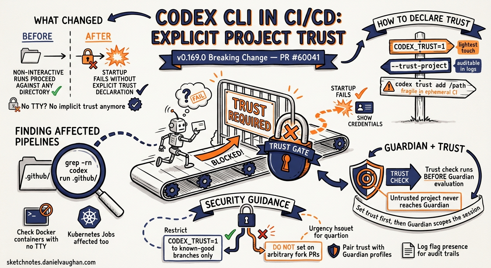

# Codex CLI in CI/CD: The New Explicit Project Trust Requirement (#60041)




---

A breaking change landed quietly in the v0.169.0 alpha sprint. PR #60041 — merged 7 November 2026 — requires that any Codex CLI invocation running in non-interactive mode explicitly declare project trust before execution proceeds.[^1] For teams with Codex wired into CI/CD pipelines, this change will produce silent failures or error exits until a trust declaration is added.

This article explains what changed, why it matters, and how to update your pipelines.

## What Changed

Before #60041, Codex CLI running in a non-interactive context (no TTY attached, `--no-interactive` flag, or piped input) would proceed against the current working directory using whatever trust posture the session inherited. If the directory had been trusted in a prior interactive session and that state was persisted, fine. If not, Codex would still run — it simply had no interactive pathway to ask the user for confirmation.

After #60041, non-interactive runs against an untrusted project directory **fail at startup** rather than proceeding. The check is explicit: Codex inspects whether the current project has been declared trusted for non-interactive execution and aborts if it has not.

The rationale is sound. A CI runner executing Codex against a repository it checked out is, by definition, running against external content — potentially a fork, a pull-request branch, or a third-party dependency. Implicit trust in that context is a supply-chain risk. The change forces an intentional declaration.

## How to Declare Trust

There are two supported mechanisms.

### Environment variable

Set `CODEX_TRUST=1` in your pipeline environment before invoking Codex:

```bash
export CODEX_TRUST=1
codex run --no-interactive "run the test suite and report failures"
```

This is the lightest-touch approach and works for most CI systems. Set it at the job or step level rather than globally to minimise blast radius.

### Explicit flag

Pass `--trust-project` (or the equivalent config key) on the command line:

```bash
codex run --no-interactive --trust-project "run the test suite and report failures"
```

The flag is explicit and auditable in pipeline logs, making it the preferred approach for regulated environments where configuration-as-code and audit trails matter.

### Persistent project trust (config pre-registration)

For teams that pre-warm Codex sessions interactively before handing off to CI, you can pre-register trust for a project directory in your user-level config. Either answer `y` to the one-time trust prompt when you first open the project in an interactive session, or set the trust level directly in `~/.codex/config.toml`:

```toml
# ~/.codex/config.toml — pre-register project trust at user level
[projects."/path/to/project"]
trust_level = "trusted"
```

Subsequent non-interactive invocations against that path will pass the check without a flag or environment variable. This approach is fragile in ephemeral CI environments where the workspace is recreated per run — use the flag or environment variable instead.

## Checking Your Pipelines

If your pipeline calls `codex` directly (not via a wrapper), search for non-interactive invocations:

```bash
grep -rn "codex run\|codex exec\|codex --no-interactive" .github/ .gitlab-ci.yml Makefile
```

For each match, confirm that the invocation either sets `CODEX_TRUST=1` in the environment or passes `--trust-project`. Invocations in Docker containers or Kubernetes Jobs that do not attach a TTY are also affected — the same environment variable or flag applies.

## Impact on Guardian-Enabled Pipelines

If you are running Codex with Guardian policies in CI, the trust check runs before Guardian evaluation. An untrusted project will not reach Guardian at all — the process exits at the trust gate. Set trust first, then allow Guardian to evaluate the session goal.

## Security Posture Guidance

The change is a step forward, but explicit trust should not be granted unconditionally. Treat the trust declaration as a signal in your pipeline security review:

- **Restrict `CODEX_TRUST=1` to jobs that run against known-good branches** (e.g. `main`, tagged releases). Do not set it on jobs triggered by arbitrary pull requests from forks.
- **Pair trust with Guardian profiles** that scope what Codex is allowed to do in CI. A trusted project with an unrestricted Guardian policy is still a risk.
- **Log the flag presence** in your pipeline output so security teams can audit which jobs run with elevated Codex trust.

The enforcement mechanism in #60041 is binary — trusted or not — but your pipeline design can be more nuanced. Use it as an opportunity to audit which CI jobs genuinely need Codex access and ensure Guardian policies are appropriately restrictive for each.

## Summary

| Before #60041 | After #60041 |
|---|---|
| Non-interactive runs proceed against any directory | Non-interactive runs require explicit trust declaration |
| Trust check skipped when no TTY | Trust check enforced regardless of TTY |
| Silent implicit trust in CI | Explicit `CODEX_TRUST=1` or `--trust-project` required |

The change lands in v0.169.0, currently in alpha. Update your pipelines before the stable release to avoid broken builds on upgrade.

---

[^1]: PR #60041 — "Require explicit project trust in non-interactive runs" — merged 7 November 2026 as part of the v0.169.0-alpha.2 sprint window.
