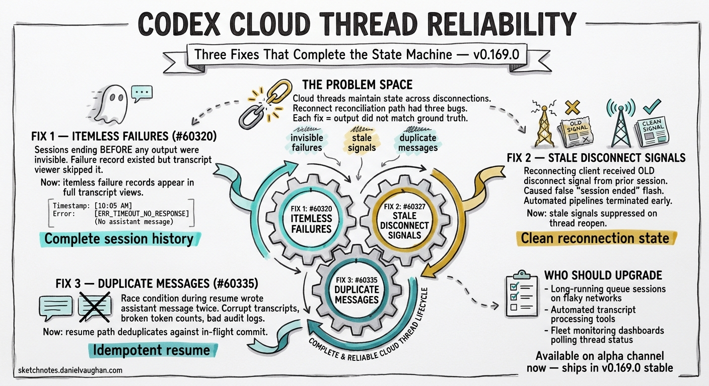

# Codex Cloud Thread Reliability: Three Fixes That Complete the State Machine

---

Three targeted PRs merged in the v0.169.0 alpha sprint — #60320, #60327, and #60335 — address distinct failure modes in Cloud thread resumption and transcript accuracy.[^1] Taken individually, each is a minor fix. Taken together, they close a cluster of edge cases that have caused transcript inconsistency and false session-end signals for teams running long-lived Cloud sessions with unreliable network connections.

## The Problem Space

Codex Cloud threads maintain state across disconnections. When a client reconnects — after a network drop, a client restart, or an intentional session handoff — the Cloud backend must reconcile what the client last saw with what actually happened server-side. This reconciliation path is where all three bugs lived.

The common thread (no pun intended) is that each fix addresses a scenario where the Cloud thread state machine produced output that did not match ground truth: a failure that looked invisible, a disconnect signal that was stale, or a message that appeared twice.

## Fix 1: Include Itemless Failures in Full Transcripts (#60320)

**What broke:** Sessions that ended in a Cloud failure before producing any thread item — typically a network drop in the first few seconds, before any assistant output was streamed — were invisible in full transcript views. The failure record existed on the backend, but the transcript viewer skipped it because there was no associated thread item to anchor the display.

**Why it matters:** Operators debugging intermittent session failures had no visibility into these early-exit failures. The transcript appeared as a gap — a session that started and then had no history. Correlating the failure required digging into backend logs rather than using the transcript UI.

**What changed:** Itemless failure records are now included in full transcript views. The entry renders as a failure event with a timestamp and error code, even without an associated assistant message. Teams running fleet monitoring or retrospective debugging workflows now have complete session histories regardless of when in the session lifecycle the failure occurred.

## Fix 2: Suppress Stale Disconnect Signals on Thread Reopen (#60327)

**What broke:** Reconnecting to a Cloud thread that had an active stream open previously could trigger spurious disconnect events. The sequence looked like this: a client connected and started a streaming response, then disconnected (cleanly or not). When the client reconnected and reopened the thread, the backend replayed the prior stream state — including the disconnect signal from the previous session. The reconnecting client received this stale signal and displayed a false "session ended" indicator.

**Why it matters:** This manifested as confusing UX: a session that was actively resuming would flash a "session ended" state before settling into the correct connected state. For automated pipelines polling thread status, it could cause a premature "session complete" determination that caused the pipeline to terminate early.

**What changed:** Stale disconnect signals from prior stream connections are now suppressed when a thread is reopened. The backend tracks which disconnect signals are attributable to the current connection versus a previous one, and filters accordingly. Thread reopen now transitions cleanly to the active state without the false disconnect flash.

## Fix 3: Deduplicate Assistant Messages on Thread Resume (#60335)

**What broke:** Under a specific race condition during thread resumption, assistant messages could be written twice to the transcript. The race involved the client sending a resume request while the backend was still committing the final message from the interrupted session. Both the resume path and the commit path wrote the message, producing a duplicate.

**Why it matters:** Duplicate assistant messages corrupt the logical conversation structure. Tools that parse transcripts — post-processing pipelines, session summarisers, audit log exporters — would see the same content twice, producing incorrect token counts, broken reasoning chains, or duplicated audit entries.

**What changed:** The resume path now deduplicates against the in-flight commit before writing. If the message being committed is already present in the transcript being assembled for the resuming client, it is not written a second time. The fix is idempotent — resuming a thread with no in-flight commit is unaffected.

## Practical Guidance for Affected Workflows

### Long-running queue sessions on flaky networks

If you run `codex queue` sessions over VPN or mobile connections, all three fixes are relevant. Itemless failure records will now surface when your connection drops before any output. Stale disconnect signals will no longer cause false session-end determinations. And if you resume a session mid-commit, the transcript will remain clean.

### Automated transcript processing

If you have tooling that parses Cloud thread transcripts — extracting structured output, counting tokens, building audit trails — test against threads that have been resumed after interruption. Before #60335, any resumed thread was potentially a source of duplicates. After the fix, transcripts are deduplicated at the source, but existing transcripts captured before the fix may still contain duplicates if they were created during the affected window.

### Fleet monitoring dashboards

If your dashboard polls thread status to determine session health, the stale disconnect fix (#60327) removes a source of false negatives. Threads previously showing spurious "ended" states on reconnect should now show correct "active" states throughout the reconnection sequence.

## Status and Availability

All three PRs are merged into the v0.169.0 alpha branch. They are not backported to v0.167.0 stable. The fixes will ship with v0.169.0 stable — exact release date pending completion of the alpha cycle.

If you are running against the alpha channel (`npm install -g @openai/codex@alpha`), the fixes are already available.

## Summary

| PR | Failure mode | Impact |
|---|---|---|
| #60320 | Itemless failures invisible in transcripts | Gaps in session history for early-exit failures |
| #60327 | Stale disconnect on thread reopen | False "session ended" on reconnect |
| #60335 | Duplicate assistant messages on resume | Corrupt transcripts from resume race condition |

Together, these fixes complete a reliability pass on the Cloud thread state machine's reconnection path. For teams dependent on transcript accuracy or automated session monitoring, upgrading to v0.169.0 stable is a meaningful reliability improvement.

---

[^1]: PRs #60320, #60327, and #60335 were merged 8–9 November 2026 as part of the v0.169.0 post-alpha.3 sprint. See the sprint notes in `notes/codex-v0169-alpha-sprint-command-center-search-cloud-thread-reliability-gateway-oauth.md` for full context.
