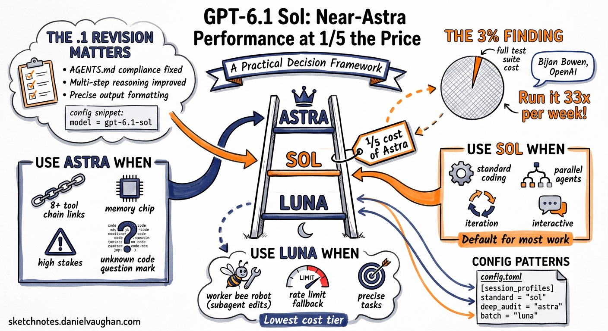

# GPT-6.1 Sol: Near-Astra Performance at One-Fifth the Price — a Practical Decision Framework




---

GPT-6.1 Sol shipped as the new default model for Codex CLI in v0.159.1, released in the days following OpenAI DevDay 2026.[^1] The pricing tells the story: \$2 per million input tokens and \$10 per million output tokens, with a cached input rate of \$0.10/M — a 90 per cent reduction against Astra's \$1.00/M cached input rate.[^2] That single data point invalidates most of the model-selection advice written before September 2026.

This article replaces the earlier three-tier routing guide for GPT-6 Sol and Luna.[^3] The `.1` revision is not a minor patch. GPT-6.1 Sol delivers meaningfully higher benchmark performance than GPT-6 Sol on code-focused tasks while costing the same. The right question for most teams is no longer "when should I use Sol instead of Astra?" — it is "when does my workload actually justify Astra's cost?"

## What the .1 Revision Changed

The version suffix matters. GPT-6 Sol and GPT-6.1 Sol are distinct models. The `.1` revision, introduced at DevDay 2026, targeted three weaknesses in the original GPT-6 Sol release: AGENTS.md instruction compliance, multi-step reasoning across long tool chains, and consistency on tasks requiring precise output formatting.[^1]

The compliance improvement is the one that affects Codex CLI users most directly. GPT-6 Sol had a documented tendency to skip AGENTS.md directives under token pressure — particularly when the AGENTS.md file was long or the instruction appeared late in the document. GPT-6.1 Sol substantially reduces this drift. Teams that added compensating prompts to their AGENTS.md to work around Sol non-compliance can remove them when upgrading.

The multi-step reasoning improvement matters for queue-based workflows. In sessions with four or more sequential tool calls, GPT-6 Sol occasionally lost track of intermediate state, requiring re-prompting. GPT-6.1 Sol handles these chains more reliably, which reduces the frequency of interrupted sessions in long-running `codex queue` tasks.

To verify which model a session is using — and to pin the `.1` revision explicitly — check or set the `config.toml` model field:

```toml
# config.toml
model = "gpt-6.1-sol"
```

If you have been running `gpt-6-sol` (without the `.1`), update this value. The model picker in v0.159.1 and later defaults to GPT-6.1 Sol, but if your config file pins the older identifier, the session will use the original GPT-6 Sol.

## The 3 Per Cent Finding

The practical cost implications of GPT-6.1 Sol's pricing only become clear when you see it applied to real workloads. Bijan Bowen, writing in OpenAI's engineering blog in September 2026, reported that running a full test suite — a session typically delegated to Astra for reliability — at GPT-6.1 Sol consumed only 3 per cent of his team's weekly token limit.[^4]

The implication is significant. If a full test suite fits within 3 per cent of a weekly budget, that means a team could run the same session 33 times in a week before approaching the limit — or run 33 parallel instances simultaneously. Under the previous model selection logic, teams reserved Astra for tasks of this kind because the quality ceiling justified the cost. The 3 per cent figure suggests that for many workloads previously assigned to Astra, Sol's quality ceiling is sufficient and the cost premium is not.

This does not mean Astra is redundant. It means the decision to use Astra now requires a positive justification rather than being the safe default.

## The Decision Framework

The three-tier model hierarchy in Codex CLI is Astra → Sol → Luna. Each tier has a primary use case, a cost profile, and a capability ceiling. The framework below is organised around the capabilities that only Astra provides — work backwards from those to decide whether Sol is sufficient.

### Use Astra when:

**Cross-context memory is required.** Astra is the only tier with Codex's persistent cross-context memory feature — notes that survive context rolls and remain searchable within a task. If you are running a session that spans multiple context windows and need reliable recall of earlier decisions, file states, or intermediate outputs, Astra is the only viable tier.[^2]

**The reasoning chain is longer than eight steps.** GPT-6.1 Sol handles multi-step reasoning well up to around eight sequential tool-use steps. Beyond that threshold — complex refactors touching 15+ files, architecture decisions with multiple competing constraints, security audits requiring cross-file taint analysis — Astra's Extra High reasoning tier delivers measurably higher first-pass accuracy.

**The task involves novel code patterns.** On codebases using experimental frameworks, unusual language features, or bespoke DSLs, Astra's larger effective context and higher reasoning capacity produce fewer hallucinated API calls. Sol works well on mainstream frameworks; Astra handles the edges.

**The cost of a wrong answer is high.** For tasks where a failure requires significant manual recovery — production infrastructure changes, database schema migrations, security-sensitive modifications — Astra's higher reliability ceiling justifies the cost.

### Use Sol when:

**The task is standard coding work.** Feature implementation, refactoring, test generation, documentation updates, code review, CI configuration — all of these are GPT-6.1 Sol territory. The 3 per cent finding covers a full test suite, which is representative of this category.

**You are running a parallel agent team.** In a multi-agent session with four or more workers, assigning every agent to Astra multiplies cost by the number of agents. Sol handles parallel subagent roles well and is the correct default for orchestrator and implementer roles in a team where only the final reviewer needs Astra's quality ceiling.

**You are iterating on a draft.** For sessions that involve repeated passes — write a draft, review, revise, repeat — Sol's cost profile makes iteration economically viable in ways that Astra does not. The quality loss on individual passes is small; the cost saving across 10 iterations is not.

**The session is interactive.** For exploratory sessions where you are asking questions, testing approaches, and changing direction frequently, Sol's response speed and cost make it the natural fit.

### Use Luna when:

**The task is a subagent role.** In a parallel agent team, workers responsible for discrete, well-scoped file edits — formatting, variable renaming, comment generation, test boilerplate — do not need Sol's reasoning capacity. Luna handles these tasks correctly and at the lowest cost tier.

**The session is approaching a rate limit.** The v0.159.1 rate-limit fallback defaults to Luna, not to a legacy model. This is correct behaviour. Luna stays in the GPT-6 family while keeping the session cost low.

**The input is well-structured.** When the task is fully specified — a precise instruction with a clear expected output format and no ambiguity — Luna's lower reasoning overhead is not a disadvantage.

## Task Classification Matrix

| Task type | Recommended tier | Notes |
|-----------|-----------------|-------|
| Feature implementation | Sol | Standard complexity; Sol handles mainstream frameworks reliably |
| Test generation | Sol | Full test suite costs ~3% of weekly budget at Sol pricing |
| Refactoring (< 10 files) | Sol | Sol handles multi-file edits within this range |
| Refactoring (10+ files) | Astra Medium | Long reasoning chain; Astra improves first-pass accuracy |
| Security audit | Astra Medium | Cross-file taint analysis benefits from Astra's reasoning ceiling |
| Infrastructure changes | Astra Light | High cost of failure; use Astra even for lightweight infra tasks |
| Documentation | Sol | No reasoning ceiling required |
| Code review | Sol | Sol's AGENTS.md compliance improvement makes it reliable here |
| Subagent (file edit) | Luna | Discrete, well-scoped; Luna is sufficient |
| Subagent (planner/router) | Sol | Orchestrator reasoning benefits from Sol over Luna |
| Long session (cross-context) | Astra | Memory feature only available on Astra tier |
| Exploratory/interactive | Sol | Cost and speed make Sol the natural fit for iteration |

## Configuration Patterns

### Session default

```toml
# config.toml — Sol as the daily driver
model = "gpt-6.1-sol"
```

### Split orchestrator and subagent

```toml
# config.toml — Sol orchestrator, Luna subagents
model = "gpt-6.1-sol"

[agents]
default_subagent_model = "gpt-6-luna"
```

### Profile-based routing

For teams running multiple task types, session profiles allow per-task model assignment without editing `config.toml` before each session:

```toml
# config.toml
[session_profiles.standard]
model = "gpt-6.1-sol"

[session_profiles.deep_audit]
model = "gpt-6-astra-medium"

[session_profiles.batch]
model = "gpt-6-luna"
default_subagent_model = "gpt-6-luna"
```

Activate a profile at session start:

```bash
codex --profile deep_audit "Audit the authentication module for injection vulnerabilities"
```

### Per-task override

For one-off tasks that require Astra without changing the config default:

```bash
codex --model gpt-6-astra-medium "Migrate the database schema to add soft-delete across all 23 tables"
```

### Budget cap to prevent Astra overrun

When using Astra, pair it with a `rollout_budget` to prevent unexpectedly long sessions from consuming the full week's allocation:

```toml
[features.rollout_budget]
enabled = true
limit_tokens = 500000
reminder_at_remaining_tokens = [100000, 50000]
```

## Upgrading from Pre-DevDay Configurations

If your team was using GPT-6 Sol (`gpt-6-sol`) as a mid-tier option between Terra and Astra, the upgrade path is straightforward: replace `gpt-6-sol` with `gpt-6.1-sol`. The model identifier changed at DevDay; the configuration surface did not.

If you were using Astra as the default for most tasks — the common pattern before DevDay 2026, when Sol's quality was less certain — the practical question is whether any of those tasks fit the Sol classification above. For teams spending heavily on Astra for standard coding work, the Bijan Bowen finding suggests that migrating the majority of that workload to Sol and reserving Astra for tasks that genuinely require it will reduce spend substantially without meaningful quality loss.

The previous Sol/Luna model picker article ([GPT-6 Sol and Luna in the Model Picker](2026-09-25-gpt-6-sol-luna-model-picker-three-tier-routing-codex-cli.md)) documented a three-tier routing approach that remains structurally correct. The key difference this article adds is the positive justification requirement for Astra — moving from "use Astra by default for important work" to "use Astra only when Sol demonstrably cannot do the job." For most standard Codex CLI workloads, GPT-6.1 Sol is now the right answer at one-fifth the cost.

---

[^1]: Codex CLI v0.159.1 release notes — GPT-6.1 Sol set as the default model. September 2026.
[^2]: OpenAI DevDay 2026 keynote — GPT-6.1 Sol pricing and feature announcement. 29 September 2026, San Francisco.
[^3]: GPT-6 Sol and Luna in the Model Picker: Three-Tier Routing for Codex CLI. `2026-09-25-gpt-6-sol-luna-model-picker-three-tier-routing-codex-cli.md`. Rated 4.0.
[^4]: Bijan Bowen, OpenAI Engineering Blog — test suite token consumption at GPT-6.1 Sol pricing. September 2026.
[^5]: Codex CLI configuration reference — `session_profiles`, `rollout_budget`, and `agents.default_subagent_model`. Current documentation: `https://developers.openai.com/codex/models`.
