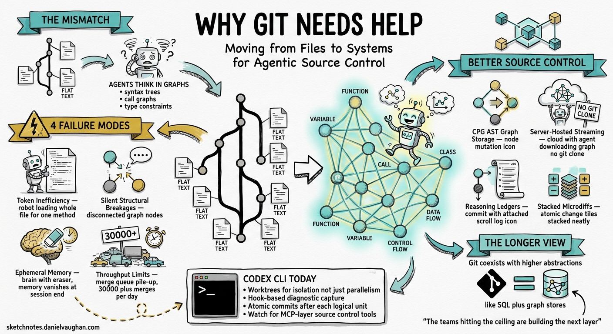

Git was designed in 2005 for humans collaborating over text. That design assumption — that code is flat text, that diffs are line-based, and that history is a sequence of human-authored commits — underpins every major version control system in production today. For two decades, it was correct enough. For agentic development at scale, it is becoming a bottleneck.

This article synthesises the emerging case for rethinking source control in an agentic world, drawing on the O'Reilly Radar analysis by Jason Davenport and the patterns now visible in Codex CLI workflows.[^1] The argument is not that Git should be replaced tomorrow, but that the assumptions it encodes are increasingly at odds with how agents read, write, and reason about code.

---

## The Core Mismatch

Autonomous coding agents do not think in flat text files or line breaks. They reason across syntax trees, execution traces, call graphs, and type constraints. When you ask Codex CLI to update a method signature across forty microservices, the agent must process thousands of surrounding lines of irrelevant boilerplate to reach the nodes it actually needs to change. That is a token problem, an accuracy problem, and a latency problem simultaneously.

Git's text-based diff engine compounds this. A diff that moves a function from one file to another looks like a deletion plus an insertion — not a semantic rename. A refactor that updates an interface and all forty implementing classes generates a diff Git treats as forty unrelated file edits, with no structural link between them. For a human reviewer, the connection is obvious. For an agent operating at scale, the lack of structural encoding means it must reconstruct those relationships from raw text on every pass.

The result, as Davenport observes, is that "agents encounter structural blindness" — they can pass syntax checks without detecting multi-file dependency breakage, because Git itself has no concept of a cross-file dependency.[^2]

---

## Four Failure Modes at Agentic Scale

### 1. Token Inefficiency

A Codex CLI agent making a targeted change to a single method still loads the full surrounding file into context. In a monorepo with 40,000 files, even shallow context-gathering burns significant token budget before the first edit. Multiply this by the number of parallel worktree agents in a multi-agent workflow, and the per-task cost compounds rapidly.

### 2. Silent Structural Breakages

Text-based diffs cannot detect broken callers across modules. An agent can produce a syntactically valid commit that silently breaks an interface contract three packages away. Git's pre-commit hooks and CI can catch some of this, but they do so by running builds and tests — expensive operations that occur after the fact rather than preventing the structural error at the source control layer.

### 3. Ephemeral Diagnostic Memory

When a Codex CLI session ends, all diagnostic history disappears: the failed attempts, the compiler feedback, the shell outputs, the reasoning traces. The next agent session that picks up the same task must rediscover the same dead ends. This is not just inefficient — it means teams running background agents on long-horizon tasks pay full rediscovery costs every time an agent restarts.

This is especially visible in Codex worktree workflows. A worktree-based parallel agent team can produce clean commits with no record of why three alternative approaches were tried and abandoned. The commit message captures the outcome; nothing captures the path.

### 4. Infrastructure Throughput Limits

Anthropic's internal infrastructure reportedly reached 30,000+ daily monorepo merges in late 2026 as agentic workloads scaled.[^3] Traditional Git infrastructure — push hooks, branch protection rules, merge queues — was not designed for that order of magnitude. The result is queue congestion, CI saturation, and merge conflicts generated not by human decisions but by agent scheduling gaps.

This is a signal about where the ceiling is. Teams operating agentic pods at scale will hit it; most have not yet because their agent counts are still low.

---

## What Better Source Control Looks Like

Davenport proposes four structural shifts. These are directional rather than immediately actionable — none are available as drop-in replacements for Git today — but they clarify what the next generation of version control must provide.

### Graph-Based Code Representation

Replace flat file storage with Code Property Graphs (CPGs) and Abstract Syntax Trees (ASTs). An agent mutating a method signature updates a node in a graph rather than editing a line in a text file. The graph encodes relationships — callers, implementors, dependencies — that agents can traverse directly rather than inferring from text.

```text
# Today: agent reads file, parses text, finds method, edits line, writes file
# CPG model: agent queries graph for method node, mutates node, change propagates
```

This eliminates the token overhead of loading irrelevant file content and enables structural diff — a diff that says "this interface node gained a parameter" rather than "line 47 changed in file A, line 83 changed in file B, line 201 changed in file C."

### Server-Hosted Architecture

Eliminate local file checkouts for agents. Instead, agents stream code graphs via fast endpoints — no `git clone`, no working tree, no disk I/O. For CI-integrated and headless agent workflows (the pattern Codex CLI's `codex exec` command targets), this reduces setup overhead by an order of magnitude.

The tradeoff is IDE compatibility. Existing toolchains expect local files. Compatibility layers exist but add complexity. This is why the transition is measured in years, not quarters.

### Persistent Reasoning Ledgers

Attach structured execution traces, compiler logs, and decision trees directly to commits as first-class objects. A commit in this model carries not just the diff but the diagnostic trail: what the agent tried, what failed, what constraint it was optimising for.

This directly addresses the ephemeral memory problem. When an agent picks up a task where a previous agent left off, it can query the ledger rather than starting blind. For long-horizon agentic tasks — the kind Codex CLI's background agent and worktree orchestration patterns are designed for — this is the difference between a system that learns from its own history and one that does not.

### Stacked Microdiffs

Deploy atomic, isolated code modifications verified sequentially rather than batched into large commits. Each microdiff is small enough to verify independently, reducing the blast radius of a failed check and enabling safe parallel agent work without merge races.

This maps closely to the worktree isolation pattern already in Codex CLI: agents work in isolated worktrees, then merge. The difference is that stacked microdiffs encode this isolation at the version control layer rather than relying on the agent orchestration layer to manage it.

---

## Implications for Codex CLI Workflows Today

None of this requires waiting for a new version control system. The practical implications for teams running Codex CLI now:

**Use worktrees for isolation, not just parallelism.** Worktrees prevent merge races between concurrent agents, which is the most immediate form of the infrastructure throughput problem. If you are running more than two parallel agents on the same repository, worktrees are not optional.

**Instrument agent sessions for diagnostic capture.** Use Codex CLI hooks (`PostToolUse`, `SessionStop`) to write structured logs of agent actions to a persistent location. This is a manual approximation of the reasoning ledger pattern — it does not integrate with Git, but it means the next agent session can at least read what happened.

**Keep agent-authored commits small and atomic.** The stacked microdiff pattern is achievable today. Instruct agents to commit after each logical unit of work rather than batching changes. Combined with Codex CLI's approval workflow, this gives human reviewers smaller, more reviewable units and reduces the size of rollbacks when a check fails.

**Anticipate MCP-layer source control tools.** The Azure Resource Manager MCP server announced at Microsoft Ignite 2026 — which creates, updates, and deletes cloud resources via ARM, gated by Azure Policy — is a preview of what source control integration via MCP could look like. A source control MCP server that exposes structural queries (find all callers, diff by AST node, attach diagnostic context to a commit) would let Codex CLI agents work at a higher semantic level without waiting for Git itself to change.

---

## The Longer View

Git will not disappear. It will coexist with higher-level abstractions that address the structural blindness and diagnostic memory problems, in the same way that SQL databases coexist with the graph and vector stores that handle the cases where relational models are the wrong fit.

The transition timeline depends on two things: how fast agent counts per repository grow, and how fast the tooling ecosystem responds. For most teams today, Git is still adequate. For teams running 50+ concurrent agents on a monorepo, it is already a constraint. The teams building the next layer of tooling are the ones who have already hit that constraint.

Codex CLI is part of the reason the constraint is becoming visible. It has made it easy to run many agents in parallel, which means it is also making the limits of the infrastructure those agents run on visible faster than expected.

---

*Research date: 2026-11-19 | Sources: O'Reilly Radar[^1][^2][^3], Seroter #911 reading list (Nov 17 2026)*

[^1]: Davenport, J. "Why Git Needs Help: Moving from Files to Systems for Source Control." O'Reilly Radar, 2026. <https://www.oreilly.com/radar/why-git-needs-help-moving-from-files-to-systems-for-source-control/>
[^2]: Ibid.
[^3]: Ibid. — Anthropic monorepo throughput figure cited in the infrastructure bottlenecks section.
