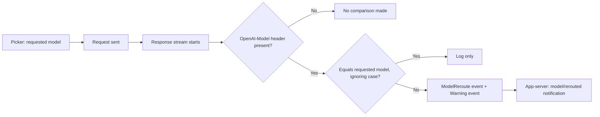

The model name in the Codex picker is what the client asked for. It is not a record of which model replied. Codex's own source contains a mechanism that exists precisely because the two can differ, and it has some sharp edges that matter if you track cost, quality or compliance by model.

This article reads the open-source client at commit `9ba0cea` (24 November 2026)[^1] to answer three questions: where does the model list come from, what does Codex do when the server answers with a different model, and where can you capture that fact afterwards. A backlog note prompted by a community video claimed the list is fetched on every session start and that a server can swap models without any signal. The code says something more precise on both points.[^2]

---

## Where the Model List Comes From

The list is not hard-coded into the binary, and it is not fetched fresh on every launch either. `codex-rs/models-manager` owns it, and its refresh policy has four named strategies:[^3]

| Strategy | Behaviour |
|----------|-----------|
| `InMemory` | Use the catalogue already in memory; no cache read, no network |
| `Online` | Always fetch from the network, ignoring the cache |
| `Offline` | Use cached data only; never fetch |
| `OnlineIfUncached` | Use the cache if it is fresh, otherwise fetch |

The default cache lives in a file called `models_cache.json` and has a time-to-live of 300 seconds.[^4] A cached entry is only reused if its client version and an opaque provider-and-auth identity match the current session; legacy entries without an identity count as a miss.[^5] So a session that starts within five minutes of the last fetch, on the same account and client version, may reuse the catalogue. Otherwise, it asks the server.

There is also an invalidation path that does not wait for the TTL. Every streamed response can carry an `X-Models-Etag` header, which the client forwards as a `ModelsEtag` event.[^6] The manager exposes `refresh_if_new_etag`, which re-fetches with the `Online` strategy when the ETag differs from the cached one.[^7] In practice: if OpenAI changes the catalogue mid-session, the next response tells the client to refresh.

### Visible, hidden and absent models

Each catalogue entry carries a `visibility` value with three variants: `List`, `Hide` and `None`.[^8] The picker shows an entry only when it is `List`; the conversion to a picker preset sets `show_in_picker` to exactly `info.visibility == ModelVisibility::List`.[^9]

What this means is narrow and worth stating precisely. A `Hide` entry is in the catalogue but not in the menu. The source I read does not say anything about what a server does with such a model beyond that. Whether OpenAI pre-loads unreleased models as `Hide` is an inference a reader might make, not something the client code shows.

One more detail: when the remote catalogue contains at least one `List` entry and the account is a ChatGPT account (or API-key discovery is enabled), the manager treats the catalogue as remote-only and skips the bundled fallback list.[^10] A signed-in ChatGPT user therefore sees the server's menu, not a baked-in one.

---

## What Happens When the Server Answers With a Different Model

When a streamed response arrives, the client reads an `OpenAI-Model` header from it. Both the server-sent-events path and the WebSocket path do this, and each emits a `ServerModel` event.[^11] The enum's own doc comment states the intent: this value "can differ from the requested model when backend safety routing applies".[^12]

The turn loop handles that event once per turn.[^13] The comparison itself is plain:[^14]

```rust
let server_model_normalized = server_model.to_ascii_lowercase();
let requested_model_normalized = requested_model.to_ascii_lowercase();
if server_model_normalized == requested_model_normalized {
    info!("server reported model {server_model} (matches requested model)");
    return false;
}
```

If the two strings differ after lower-casing, Codex does three things:

1. Logs a `warn!` line: `server reported model X while requested model was Y`.
2. Emits a `ModelReroute` event carrying `from_model`, `to_model` and a `reason`.
3. Emits a user-visible `Warning` event.

So the premise that the substitution is entirely silent is wrong for the terminal client: the user is shown a warning. A per-turn flag stops the warning repeating on every streamed step of the same turn.[^13]



### Two caveats worth knowing

**The reason is hard-wired.** `ModelRerouteReason` has exactly one variant, `HighRiskCyberActivity`.[^15] The warning text is a fixed string that says the account "was flagged for potentially high-risk cyber activity" and that the request "was routed to gpt-5.2 as a fallback," with a pointer to trusted access for `gpt-5.3-codex`.[^14] Those model names are literal text in the source; they are not filled in from the event. In this version of the code, any case-insensitive mismatch between the requested model and the header is reported with that reason and message. I have not tested whether a non-cyber mismatch (for example an alias resolving to a dated snapshot name) can reach this branch in production, so treat the label as the client's classification, not proof of why the server chose differently. The reliable fields are `from_model` and `to_model`, which are filled from the real values.[^14] The earlier article on cyber-safety rerouting covers the policy side of the same mechanism.[^16]

**A missing header means no comparison.** The check runs only when the server includes `OpenAI-Model`. If a provider or gateway does not send it, Codex has nothing to compare and says nothing.[^11]

---

## Where You Can (and Cannot) Capture It

This is the practical part for anyone tracking usage by model.

**Persisted session logs do not keep the reroute.** In the rollout policy, `EventMsg::Warning` and `EventMsg::ModelReroute` both sit in the group labelled "Transient, non-durable events", which maps to `None`, meaning not written to the rollout file.[^17] If you later grep a saved session for evidence of a reroute, it will not be there.

**The app-server does expose it live.** The v2 protocol defines a `model/rerouted` notification carrying `threadId`, `turnId`, `fromModel`, `toModel` and `reason`.[^18] A client or wrapper that speaks the app-server protocol can write each notification to its own log as it arrives. That is the one first-class, structured signal in the code I read.

**Logs at `info`/`warn` level include the server's model.** The `info!` and `warn!` lines above are emitted by the client, so with logging enabled they record the server-reported model against the requested one. I did not verify where those logs are written for every install, so check your own configuration.

A minimal recipe for a team that needs ground truth:

1. Run Codex through a client that consumes app-server notifications.
2. Append every `model/rerouted` notification to a log with timestamp, thread and turn IDs.
3. Reconcile that log against your billing or usage export by thread and time, treating the server-side record as authoritative for what was charged.

I have not examined the usage export format here, so step 3 describes the method, not a tested procedure.

---

## What This Does Not Show

- **It does not explain the usage-dashboard mismatches users have reported.** The forum threads about a plan's flagship model appearing under a different name in usage analytics describe a display and accounting layer that lives server-side. This client code cannot show that.
- **It does not show what the server does with `Hide` models.** Only the client's reading of the field is public here.
- **It reflects one commit.** The file layout and the hard-coded message are as of `9ba0cea`; the next release may change either.

---

## Summary

Three things in the client are worth remembering. The model list is a cached, ETag-refreshed catalogue with a 300-second TTL, not a per-launch fetch. The `visibility` field decides only whether a model appears in the picker. And when the server reports a different model in `OpenAI-Model`, Codex does warn, but it labels every such mismatch as a high-risk-cyber reroute with fixed model names in the text, and it does not write the event to the saved session.

If you care which model answered, record the `model/rerouted` notification yourself and trust its `from_model` and `to_model`, not the sentence shown to the user.

---

[^1]: openai/codex, `main` at commit [9ba0cea](https://github.com/openai/codex/commit/9ba0ceac1ae9a72b1198f492a252b12c061ae399), committed 24 November 2026. All source references below are to this commit.
[^2]: Claims in the backlog note derive from "GPT-6.2 Astra Already Ran in Codex. Nobody Could Pick It," Simply AI, YouTube, 2026-11-06, [youtube.com/watch?v=BcpOMU5RcWw](https://www.youtube.com/watch?v=BcpOMU5RcWw). No transcript was available, so nothing here relies on the video; the code is the source.
[^3]: `RefreshStrategy` enum, [`codex-rs/models-manager/src/manager.rs`](https://github.com/openai/codex/blob/9ba0ceac1ae9a72b1198f492a252b12c061ae399/codex-rs/models-manager/src/manager.rs), lines 123–134.
[^4]: `MODEL_CACHE_FILE` (`models_cache.json`) and `DEFAULT_MODEL_CACHE_TTL` (300 seconds), same file, lines 42–43; `ModelCatalogSettings::disk` builds the file cache with that TTL (lines 398–401).
[^5]: [`codex-rs/models-manager/src/cache.rs`](https://github.com/openai/codex/blob/9ba0ceac1ae9a72b1198f492a252b12c061ae399/codex-rs/models-manager/src/cache.rs): `client_version` and `identity` fields on the cache entry, "Unscoped legacy entries are cache misses," and `is_fresh(ttl)` comparing `fetched_at` against the TTL.
[^6]: [`codex-rs/codex-api/src/sse/responses.rs`](https://github.com/openai/codex/blob/9ba0ceac1ae9a72b1198f492a252b12c061ae399/codex-rs/codex-api/src/sse/responses.rs), lines 47–52 (reads `X-Models-Etag`) and `ResponseEvent::ModelsEtag` send at line 86.
[^7]: `refresh_if_new_etag` ("Refresh models if the provided ETag differs from the cached ETag. Uses `Online` strategy"), `manager.rs` lines 348–356.
[^8]: `ModelVisibility { List, Hide, None }`, [`codex-rs/protocol/src/openai_models.rs`](https://github.com/openai/codex/blob/9ba0ceac1ae9a72b1198f492a252b12c061ae399/codex-rs/protocol/src/openai_models.rs), lines 307–312.
[^9]: Same file, line 1120: `show_in_picker: info.visibility == ModelVisibility::List`.
[^10]: `manager.rs` lines 1015–1025: `remote_only` is true when any model is `List` and API-key discovery or a ChatGPT-account auth mode applies; the bundled fallback is merged only when `!remote_only`.
[^11]: `OPENAI_MODEL_HEADER = "openai-model"` and the `ResponseEvent::ServerModel` send in `sse/responses.rs` (lines 37, 53–57, 78–80); the WebSocket equivalent is in [`responses_websocket.rs`](https://github.com/openai/codex/blob/9ba0ceac1ae9a72b1198f492a252b12c061ae399/codex-rs/codex-api/src/endpoint/responses_websocket.rs) (header constant at line 430; event emitted around lines 1237–1252 when the model changes).
[^12]: [`codex-rs/codex-api/src/common.rs`](https://github.com/openai/codex/blob/9ba0ceac1ae9a72b1198f492a252b12c061ae399/codex-rs/codex-api/src/common.rs), lines 208–210.
[^13]: `ResponseEvent::ServerModel` handler and the `server_model_warning_emitted` flag, [`codex-rs/core/src/session/turn.rs`](https://github.com/openai/codex/blob/9ba0ceac1ae9a72b1198f492a252b12c061ae399/codex-rs/core/src/session/turn.rs), lines 3674–3687.
[^14]: `maybe_warn_on_server_model_mismatch`, [`codex-rs/core/src/session/mod.rs`](https://github.com/openai/codex/blob/9ba0ceac1ae9a72b1198f492a252b12c061ae399/codex-rs/core/src/session/mod.rs), lines 4890–4925.
[^15]: `ModelRerouteReason` and `ModelRerouteEvent`, [`codex-rs/protocol/src/protocol.rs`](https://github.com/openai/codex/blob/9ba0ceac1ae9a72b1198f492a252b12c061ae399/codex-rs/protocol/src/protocol.rs), lines 2434–2443.
[^16]: [Codex CLI Cyber Safety: Understanding Model Rerouting, Trusted Access, and the False Positive Problem](2026-04-30-codex-cli-cyber-safety-trusted-access-model-rerouting-defence.md), this repository.
[^17]: [`codex-rs/rollout/src/policy.rs`](https://github.com/openai/codex/blob/9ba0ceac1ae9a72b1198f492a252b12c061ae399/codex-rs/rollout/src/policy.rs): the "Transient, non-durable events" arm (from line 162) lists `Warning` (line 175) and `ModelReroute` (line 184) and resolves to `None`.
[^18]: `ModelReroutedNotification` and the `model/rerouted` method, [`codex-rs/app-server-protocol/src/protocol/v2/model.rs`](https://github.com/openai/codex/blob/9ba0ceac1ae9a72b1198f492a252b12c061ae399/codex-rs/app-server-protocol/src/protocol/v2/model.rs) lines 208–216 and [`protocol/common.rs`](https://github.com/openai/codex/blob/9ba0ceac1ae9a72b1198f492a252b12c061ae399/codex-rs/app-server-protocol/src/protocol/common.rs) line 2169.
