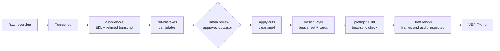

Most advice on writing skills is abstract: keep them small, give each one a job, put verification in. The Herk Edit Kit is a public repository that does all of that in one domain, video editing, which makes it a convenient specimen to read. This article reads the repository at commit `10511e5` (14 October 2026)[^1] and the Codex source at `9ba0cea` (24 November 2026)[^2] to see how the pieces fit, and what you can copy, whatever you are building.

A note on sourcing. The backlog idea for this piece came from a YouTube video by Nate Herk, the kit's author.[^3] No transcript was available, so nothing below relies on the video. Every claim is from the repository's own files or from the Codex client source. Where the backlog note said something the repository does not support, this article says so.

---

## What the Kit Is

The README describes a kit for "Codex and Claude Code, built on HyperFrames", with 15 skills, 406 draft motion-graphics cards, two scene templates, and tools for transcription, silence cutting, mistake detection, transcript retiming, review and preflight checks.[^4] HyperFrames is a framework that renders video from HTML and GSAP timelines; the kit uses it as the rendering layer.

Two counts need care. The README says 15 skills and both `.agents/skills/` and `.claude/skills/` contain 15 directories. The kit's own release notes, however, say "all 14 canonical skills passed frontmatter validation".[^5] The likely explanation is that the notes were written before the last skill was added, but the repository does not say. Treat "15 directories, 14 in the last verification note" as the accurate statement.

Five of the 15 are not the author's. `skills-lock.json` records `gsap`, `hyperframes`, `hyperframes-cli`, `hyperframes-registry` and `website-to-hyperframes` as installed from `heygen-com/hyperframes`, each with a content hash.[^6] That leaves ten written for this kit, which is a more modest and more useful number: ten skills of one author's own, sitting on five vendored framework skills.

---

## Layer 1: One Job per Skill, a Router on Top

The standing guide, `AGENTS.md`, opens with a routing table mapping a need to a skill.[^7] Reading its rows as a design:

| Group | Skills | Job |
|---|---|---|
| Coordinator | `edit-video` | Runs the whole edit, delegating to specialists |
| Pipeline stages | `cut-silences`, `cut-mistakes` | One edit operation each |
| Design | `video-storytelling`, `hyperframes-video-beats`, `style-library` | The visual layer |
| Alternative products | `short-form-edit`, `motion-showreel`, `make-a-video`, `website-to-hyperframes` | Different outputs from different inputs |
| Framework references | `hyperframes`, `hyperframes-cli`, `gsap`, `hyperframes-registry` | Vendored knowledge, not procedures |
| Legacy | `short-form-video` | Kept for twelve existing examples only |

Three things stand out.

**The coordinator is explicit, not fat.** `edit-video` is a numbered list of eight steps, and each step is "read the matching skill, then do its work": step 3 says "Read `../cut-silences/SKILL.md`", step 4 "Read `../cut-mistakes/SKILL.md`", and so on.[^8] It holds the order and the hand-offs; the detail lives in the specialist. This is the orchestrator pattern in its plainest form, and it keeps each specialist usable on its own: the routing table says to load `cut-silences` directly when only silence removal is wanted.

**Descriptions say when to use and when not to.** The `edit-video` description ends with "route a single requested operation directly to its specialist skill", and `short-form-video` says "Use only when working on those examples... For new reels, Shorts, or short advertisements, use `short-form-edit`."[^8][^9] A skill that tells the model when to step aside is what stops two similar skills competing for the same request.

**Deprecation is done in the open.** The legacy skill is kept, labelled, and pointed away from. The README's migration note explains that the older kit was merged in with both Git histories preserved and the old projects retained.[^10]

---

## Layer 2: Ordered Pipeline, Independent Gates

The stages chain in a fixed order. The workspace guide is blunt about it: "Cut silences first; use its edited video AND retimed transcript for cut-mistakes."[^7] Each stage writes a new output file and a new transcript retimed to match it, and the guide adds "Never mix original timestamps with edited footage." The workflow document repeats the point at the point of use: "Never use raw timings against the cleaned video."[^11]

That rule is the pipeline's real contract. Each stage's output is the next stage's only valid input, and the file names carry the stage (`raw.silence-transcript.json`, `raw.mistakes-transcript.json`). The failure it prevents, applying a time range measured on one cut to a different cut, is silent and easy to make.

Human approval is built into the stage that most needs judgement. `cut-mistakes` describes itself as "review-gated by default": a detector proposes candidates, and "Deciding what counts as a mistake is judgment, not a formula — emphatic repetition ('never, never') and rhetorical doubling look identical to a stutter mechanically."[^12] The skill requires the agent to read each candidate in context, present a recommendation per item, collect approval, write the approved cuts to `approved-cuts.json`, and only then apply them. A dry run (no `--apply`) is the default.

So the gate is not a generic "ask before doing anything" instruction. It sits exactly where a mechanical tool cannot decide, it produces a durable artefact (the approved-cuts file), and the destructive step consumes only that artefact. An empty cuts list is explicitly valid, so the gate can also resolve to "do nothing".

The guide also states what to do about approvals that were already given: "Honor approvals already provided. When review approval is missing, prepare the concrete preview or cut proposal first."[^13] `edit-video` closes the loop from the other side: "do not repeat approval requests for the same authorized action."[^8] Both halves matter; a gate that re-asks constantly gets disabled by its user.

---

## Layer 3: Verification That Admits Its Limits

The last stage of the pipeline is checking, and the guide separates what a script can prove from what a person must look at. `scripts/preflight.mjs` and `npx hyperframes lint` handle structure; `scripts/validate-beat-sync.mjs` requires each overlay beat to carry a `data-anchor` containing an exact transcript phrase and to enter within a defined window around that word.[^7] Then:

> "Never claim a lint result proves visual quality."[^13]

The agent must review the encoded draft, extract hero frames and transition boundaries, listen across cut joins, and record the evidence in `VERIFY.md`. The final deliverable list names `VERIFY.md` "describing what was checked and any remaining limitations".[^8]

The release verification document is equally candid about scope. It reports 11 passing behaviour tests, a synthetic media smoke test, and then lists what was not done: the 406 cards "retain draft status; this release did not individually render and visually approve all of them", paid transcription "was not called during release QA", and the media smoke test "checks timing and stream integrity with a tone, not subjective speech-cut quality".[^14] A skills library that documents what it has not verified is easier to trust than one that claims everything works.

Two smaller verification habits are worth lifting. The tests are behavioural: they cover silence retiming, reviewed stutter removal, empty-cut identity, invalid cut bounds and early/late beat timing, plus the short-form validators for caption drift, wrong source mapping and footage reuse.[^14] And `npm run check:skills` exists to catch drift between the two skill trees, covered next.

---

## Serving Two Agents From One Source

The kit supports both Codex and Claude Code, and the way it does so is practical. `.claude/skills/` is the canonical source; `.agents/skills/` is a generated mirror produced by `node scripts/sync-codex-skills.mjs`, with a `--check` mode for CI.[^15] The Codex setup note explains why the mirror uses real files rather than symlinks: "so Windows users do not need symlink privileges."[^16]

The mirror is not byte-identical. The sync script's own comment says "Only instructions change runtime paths; helpers and resources remain identical", and a diff of `cut-silences/SKILL.md` between the trees shows the only differences are the script paths inside the commands (`.agents/skills/...` versus `.claude/skills/...`).[^15] Instructions that include a path have to be rewritten for each runtime; everything else can be shared.

`AGENTS.md` and `CLAUDE.md` carry "the same standing guide", and the guide says to keep them synchronised by hand.[^7] There is no generator for that pair, which is a small maintenance risk the kit accepts.

On the Codex side, the client source confirms the two mechanisms the kit leans on:

- **Skill discovery.** Codex's skills extension builds its repository roots from a `.agents` directory containing `skills`, which is why the mirror lives at `.agents/skills/` rather than anywhere else.[^17]
- **Instruction loading.** Per directory, Codex's candidate list is `AGENTS.override.md`, then `AGENTS.md`, then any names in `project_doc_fallback_filenames`.[^18] The default size budget for project instructions is 32 KiB (`DEFAULT_PROJECT_DOC_MAX_BYTES = 32 * 1024`).[^19]

The kit's `.codex/config.toml` sets `project_doc_max_bytes = 65536` and `project_doc_fallback_filenames = ["CLAUDE.md"]`, with a comment that model and permissions stay under the user's control.[^20] Its `AGENTS.md` is 5,924 bytes, so the doubled budget is headroom rather than a need. The fallback to `CLAUDE.md` is also a belt-and-braces setting: because `AGENTS.md` is checked first and the two files are identical, the fallback matters only if someone deletes `AGENTS.md`. It does no harm, but it is not what makes the kit work.

The setup note adds a caveat worth remembering: "Project settings load after the user trusts the project. Restart Codex if new skills do not appear."[^16] That matches the client, where project instruction loading returns nothing for an untrusted project.[^18]

---

## The Design Skills: Rules, Not Recipes

The most distinctive skill is `video-storytelling`, and it shows how to write a design skill that is not a template. It opens by naming the failure it replaces ("scene-thinking": a new graphic every few seconds, so the viewer restarts comprehension each time) and builds on four principles: one persistent world, the camera is the edit, attention is a spotlight, open loops are spatial.[^21] A discipline section follows ("If it doesn't get a word, it doesn't get drawn"), then a build contract, gates, and an order of work.

Two features carry over to any domain. The skill distinguishes itself from its neighbour explicitly ("This is not `hyperframes-video-beats`. That skill places overlay cards on top of a talking head. This one designs the thing the video is about"), which is the same stepping-aside discipline as in the descriptions.[^21] And it ships a worked reference (`reference/patterns/wall-of-slots/`) plus a neutral practice workbook, so the principles are anchored to something concrete without requiring private source material.

---

## What to Take From It

1. **One job, one trigger, then a thin coordinator.** The coordinator lists order and hand-offs only. Specialists stay callable alone.
2. **Put the human gate where the tool cannot judge.** Make it produce a file, and make the destructive step read only that file.
3. **Name each stage's valid input.** Retimed transcripts that travel with the footage they describe removed a whole class of silent error.
4. **Write the limits down.** `VERIFY.md` and the release notes say what was not checked.
5. **Treat dual-runtime support as a build step.** One canonical tree, one sync script with a check mode, and a written reason for the file-copy choice.
6. **Describe when not to use the skill.** It is the cheapest routing fix there is.

Two caveats on the kit itself. It is a working toolkit, and its authors say so: "not a promise of fully automatic editorial judgment".[^14] And its library of 406 cards is draft status, so the count measures breadth rather than tested quality.

For the book's chapters on skill design, this repository is a useful complement to the abstract rules: the structure above is something you can reproduce in a day, in any domain with ordered stages and a few judgement calls.

---

[^1]: [`nateherkai/herk-edit-kit`](https://github.com/nateherkai/herk-edit-kit), `main` at commit `10511e5` ("Playbook: cut between phrases, never inside one"), committed 14 October 2026. All kit file references are to this commit, read from a shallow clone.
[^2]: [`openai/codex`](https://github.com/openai/codex) at commit [9ba0cea](https://github.com/openai/codex/commit/9ba0ceac1ae9a72b1198f492a252b12c061ae399), committed 24 November 2026.
[^3]: Nate Herk, "This Free Kit Turns Claude Code Into a Video Editor", YouTube, 2026-11-23, [youtube.com/watch?v=wQSv9xAO_zg](https://www.youtube.com/watch?v=wQSv9xAO_zg). Not used as a source here; no transcript was available. The backlog note described the stack as three layers (language model, FFmpeg, HyperFrames/GSAP) and the skills as chained in a fixed order with independent gates; the repository supports the chaining and the gates, and its own docs describe FFmpeg and HyperFrames as the media and rendering tools.
[^4]: Kit `README.md`, "What's included" and the opening paragraph.
[^5]: Kit `docs/VERIFICATION.md`, "Consolidated Herk Edit Kit, version 2": "All 14 canonical skills passed frontmatter validation, and all 94 skill resources match the Codex mirrors." Directory counts from `ls .agents/skills .claude/skills`: 15 each.
[^6]: Kit `skills-lock.json`: five entries, each with `"source": "heygen-com/hyperframes"` and a `computedHash`.
[^7]: Kit `AGENTS.md`: "Runtime routing", "Start and route" (the routing table), "Editing and timing" and "Verification and approvals".
[^8]: Kit `.agents/skills/edit-video/SKILL.md`: frontmatter description and the numbered steps.
[^9]: Kit `.agents/skills/short-form-video/SKILL.md`, frontmatter description.
[^10]: Kit `README.md`, "Existing examples and migration", and `docs/MIGRATION.md`.
[^11]: Kit `docs/WORKFLOW.md`, steps 2 and 3.
[^12]: Kit `.agents/skills/cut-mistakes/SKILL.md`, introduction and sections 2 ("Review (the gate — REQUIRED)") and 3 ("Apply approved cuts").
[^13]: Kit `AGENTS.md`, "Verification and approvals".
[^14]: Kit `docs/VERIFICATION.md`, including "Scope and limits"; test files in `tests/` (`editing.test.mjs`, `short-form.test.mjs`).
[^15]: Kit `scripts/sync-codex-skills.mjs` (canonical `.claude/skills`, target `.agents/skills`, `--check` flag, "Canonical Claude skills -> portable Codex mirrors. No symlinks required."), `package.json` scripts `sync:skills` and `check:skills`, and a `diff` of `cut-silences/SKILL.md` between the two trees.
[^16]: Kit `.codex/README.md`.
[^17]: [`codex-rs/ext/skills/src/host_roots.rs`](https://github.com/openai/codex/blob/9ba0ceac1ae9a72b1198f492a252b12c061ae399/codex-rs/ext/skills/src/host_roots.rs), constants `AGENTS_DIR_NAME = ".agents"` and `SKILLS_DIR_NAME = "skills"` (lines 28–29), and the tests in `host_roots_tests.rs` that expect `cwd/.agents/skills` as a repository skill root.
[^18]: [`codex-rs/core/src/agents_md.rs`](https://github.com/openai/codex/blob/9ba0ceac1ae9a72b1198f492a252b12c061ae399/codex-rs/core/src/agents_md.rs): `candidate_filenames` (lines 374–378) pushes `AGENTS.override.md` then `AGENTS.md` then configured fallbacks; `load_project_instructions` returns early when `config.active_project.is_untrusted()` or the byte budget is 0 (line 67).
[^19]: [`codex-rs/config/src/config_toml.rs`](https://github.com/openai/codex/blob/9ba0ceac1ae9a72b1198f492a252b12c061ae399/codex-rs/config/src/config_toml.rs), line 76.
[^20]: Kit `.codex/config.toml`; `AGENTS.md` size from `wc -c` (5,924 bytes).
[^21]: Kit `.agents/skills/video-storytelling/SKILL.md`, introduction and sections 1–5.
